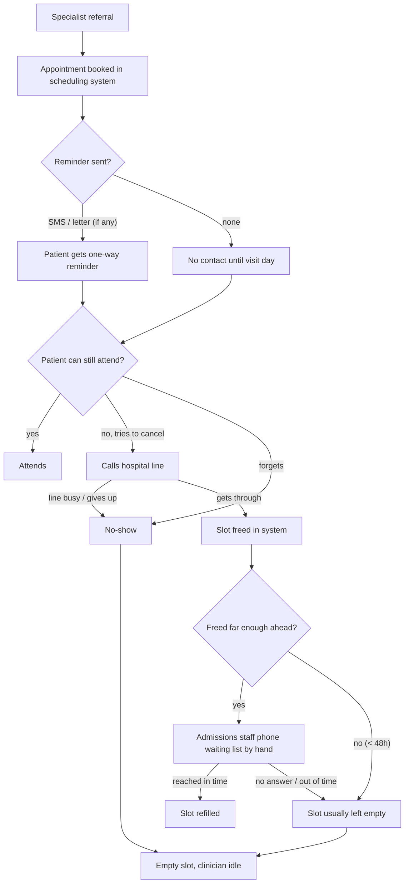

# 02 · Discovery

**Account:** a regional public health service in Spain · *Hospital General (fictional)*.
**Goal of discovery:** replace the hypotheses in `01_account_brief.md` with the hospital's own facts, find the integration path, and get the DPO and the head of admissions on side before any build.
**Format:** 5–6 sessions of 45 minutes over two weeks, plus a half-day shadowing in the admissions office.

---

## 1. Interview guide

Ground rules for every session:
- Ask about what happened last week, not what usually happens. Concrete cases beat opinions.
- No real patient data leaves the hospital during discovery. Ask for aggregate figures only.
- Close each session with: "Who else should I talk to?" and "What would make you say no to this?"

### 1.1 Head of admissions (champion): 60 min

**Today's process**
1. Walk me through what happens from the moment a specialist appointment is booked to the day of the visit.
2. What reminders go out today? SMS, letter, app, a call? Who sends them, and how many days ahead?
3. When a patient calls to cancel, how does that reach you? How long do they wait on the line?
4. When a slot frees up the day before, what happens to it? Tell me about the last time.
5. Who on your team makes outbound calls today? How many a day can they make? What do they drop when they're busy?

**Pain and priorities**
6. Which specialties hurt most on no-shows? Which have the longest waiting lists?
7. What do patients complain about most when they reach you?
8. If you had two more full-time staff for a month, what would you have them do?

**Exceptions**
9. What cases should never be handled by a machine? (Bereavement, guardianship, interpreters, complex reschedules…)
10. When a patient asks something clinical on the phone today, what does your team do?

**Success**
11. Six months from now, what number would tell you this worked?

### 1.2 Hospital director (sponsor): 30 min

1. Where does the no-show and waiting-list problem sit among your priorities this year?
2. Which waiting-list figures are you asked about most, and by whom?
3. What would a successful pilot let you say in public, and to the regional health service?
4. What would make this a reputational risk for you? What has gone wrong with past tech projects?
5. Budget: is there a line for this kind of service today (call centre, SMS), and when does next year's budget get set?
6. Would you prefer to pay per minute, per call, or per recovered slot?

### 1.3 IT / information systems: 45 min

1. Which scheduling / hospital information system handles specialist appointments? Version, vendor, hosting.
2. Does it expose an API (HL7 v2, FHIR, SOAP, REST, database views)? Read only, or write too?
3. If there's no API: how do other systems integrate today? Batch files, RPA, an integration engine?
4. How is the waiting list stored and ordered? Can it be exported in order, per specialty?
5. Where do patient phone numbers live, and how reliable are they?
6. Security requirements for a new vendor: ENS category, network access (VPN, allow-listing), SSO for staff dashboards.
7. Who supports an integration after go-live, and what's their capacity?
8. Telephony: do outbound calls need to come from a hospital number? Existing SIP trunk or contact-centre platform?

### 1.4 Data protection officer: 45 min

1. Has the hospital deployed any voice, chatbot or AI system that handles patient data? What did you require?
2. Do you agree the legal basis is care communication (GDPR 6.1.e / 9.2.h), not consent? Any internal policy that says otherwise?
3. What identity check do staff use on the phone today? Is it written down?
4. What can be said on a voicemail or to a relative today?
5. Recording: is it allowed, how is it announced, and what retention period would you accept?
6. Processor requirements: EU data residency, sub-processors, zero data retention, DPA template.
7. DPIA: does the hospital have a template, and how long does sign-off usually take?
8. Would a patient need a way to opt out of automated calls? Where should that be recorded?

### 1.5 Works council: 30 min (with HR present)

1. How were past automation or outsourcing projects in admissions received?
2. What would staff need to hear to see this as help rather than a threat?
3. Are there rules on monitoring staff performance that a dashboard might touch?
4. Who on the admissions team should be involved in testing?

### 1.6 Patient advocate: 30 min

1. Which patient groups struggle most to reach the hospital today?
2. How do elderly and rural patients react to automated calls in your experience?
3. What languages, other than Spanish and any co-official language in the region, come up most often?
4. What must the agent always offer? (A human, a callback number, opting out…)
5. Would you review the call script and test calls before the pilot?

### 1.7 Shadowing: half day in admissions

Observe and time: inbound cancellations, outbound reminder calls (if any), backfill attempts, identity checks, and how exceptions get escalated. Count how many calls end in voicemail or no answer.

---

## 2. Current-state process map (hypothesis, to validate)

**Where value leaks (hypotheses)**
1. **No two-way reminder.** SMS can't take a cancellation and pass the slot on.
2. **Cancellations blocked by busy phone lines.** The patient meant to cancel; the system records a no-show.
3. **Late-freed slots aren't refilled.** Manual backfill is too slow for slots freed 1–2 days ahead.
4. **Backfill depends on staff time.** Every unanswered call costs minutes that aren't available.

**Proposed future state (for contrast, detail in phase 5):** agent calls 3–5 days ahead → confirm / cancel / reschedule → a cancelled slot triggers backfill calls down the hospital's list, in order, until filled or out of time → anything clinical, sensitive or unclear goes to a human.

---

## 3. Baseline metrics to request

Aggregate figures only, for the last 12 months, ideally per specialty and per month. These become the pilot baseline (phase 8) and the ROI inputs (phase 4).

### Volume and no-shows
| Metric | Why |
|---|---|
| Specialist outpatient appointments (first + follow-up) | Scale |
| No-show rate, by specialty | Pick the pilot specialty |
| No-show rate, by age band and by booking delay (days from booking to appointment) | Check whether the reference-case pattern holds here: younger patients and longer delays had more no-shows (`01_account_brief.md` §2.1) |
| Reasons for no-shows, if the hospital has ever surveyed or coded them | Compare with the reference case (46% forgot or communication failure) |
| Late cancellations (< 48h) and how many were refilled | Size the backfill opportunity |
| Average and median time on the waiting list, by specialty | Political metric; ties to no-show rate |

### Current reminders and contact
| Metric | Why |
|---|---|
| Reminder channels in use and coverage (% of appointments that get one) | Defines the SMS-only control arm |
| Cost per SMS / per letter | Comparison for pricing |
| % of patients with a valid mobile number on file | Upper bound on reach |
| Language of preference, where recorded | Which agent languages to build |

### Staff and phone lines
| Metric | Why |
|---|---|
| Admissions staff FTE and hours spent on outbound calls | Capacity the agent frees |
| Inbound call volume, abandonment rate and average wait | Phone-line saturation baseline |
| Outbound call outcomes today: answered / voicemail / no answer / wrong number | Calibrates the agent's expected contact rate |

### Cost and value
| Metric | Why |
|---|---|
| Cost of a specialist outpatient visit (the regional public price list is acceptable as a proxy) | Value per recovered slot |
| Current spend on call-centre or reminder services | Budget line and price anchor |

### Data quality checks
- Can the waiting list be exported in its official order, per specialty?
- How often is it updated? (A stale list means offering a slot to someone already seen.)
- Are deceased or transferred patients removed promptly? (Calling them is a serious failure.)

---

## 4. Discovery outputs

By the end of discovery we should have:
1. A validated process map (this one, corrected).
2. The baseline table filled with real aggregates.
3. A named pilot specialty with a high no-show rate and a cooperative head of service.
4. The integration path agreed with IT (API, integration engine or batch).
5. The DPO's list of requirements, and a date for DPIA review.
6. A go / no-go on proceeding to a pilot proposal.
