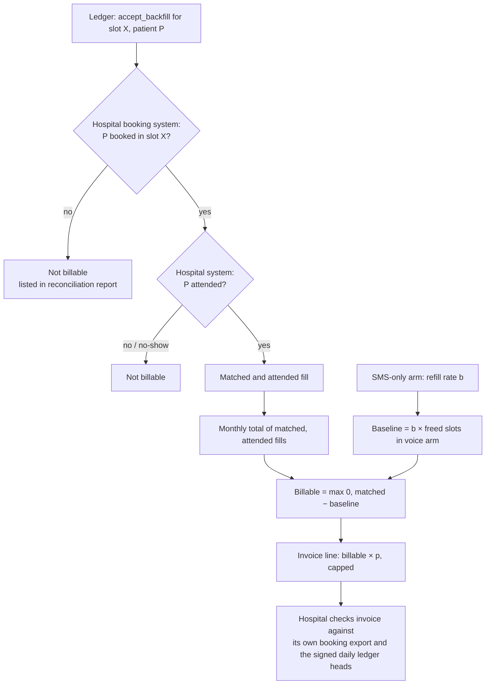
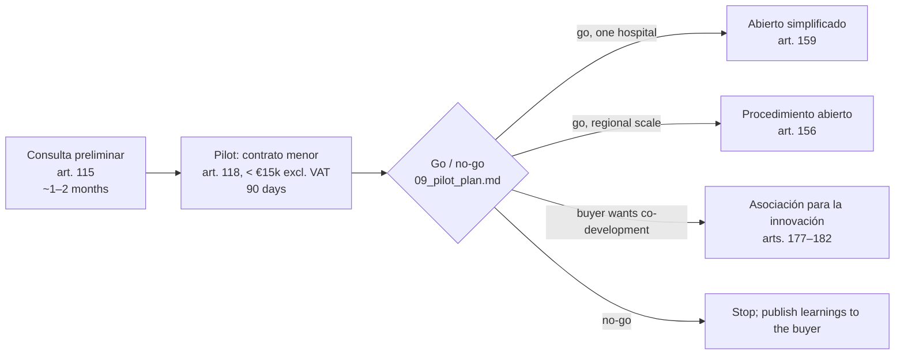

# 04 · Business case and commercials

**Account:** a regional public health service in Spain · *Hospital General (fictional)*.
**Question:** what is a recovered slot worth to the hospital, what should it cost, and how does a Spanish public hospital legally buy it?
**Short answer:** each recovered slot is worth about **€61 of capacity that would otherwise sit idle** (BENCHMARK [S2, 2013–14], our calculation). The voice agent costs a small fraction of that per slot, so the commercial risk lies in **how many** slots it recovers. We price per verified recovered slot so the hospital doesn't carry that risk, and we start with a pilot small enough for a *contrato menor*.

The interactive version of this model is the **ROI page** of the dashboard (`/roi`). Every slider there carries the same provenance tag as the table below.

**Provenance tags used in this document** (DESIGN.md, D28):

| Tag | Meaning |
|---|---|
| `BENCHMARK [S#, year]` | Published figure from another region, see `research/sources.md` |
| `SYNTHETIC` | Profile of the fictional hospital (`01_account_brief.md` §2.5) |
| `ASSUMPTION` | Our working value, to replace with discovery data or a quote. Never a result |
| `SIMULATED` | Output of the synthetic demo or the eval runs, shown only as a `{{metric:...}}` placeholder filled from `metrics/registry.json` |

No number in this document describes how Slotback performs in a real hospital. That number doesn't exist yet; the pilot (`09_pilot_plan.md`) produces it.

---

## 1. Be honest about what the €61 means

The €61 is the **average cost of a missed appointment**: €3,386,919 ÷ 55,249 missed appointments in the reference area [S2, 2013–14]. That cost is mostly fixed: the clinician, the room and the session were paid for whether the patient came or not.

So a recovered slot **does not release €61 in cash**. It means one more patient is seen for money already spent. The hospital gets:
- **capacity reused:** one more patient off the waiting list per recovered slot, without adding a clinic session;
- **a reportable number:** recovered slots and waiting-list days saved, which the director is asked about (`01` §3);
- **avoided marginal spend, where it exists:** if the hospital buys extra sessions to cut waiting lists, a recovered slot avoids part of that cost. Whether it does is a discovery question, not something we assume.

The business case is therefore framed as **"cost per additional patient seen"**, compared with what the hospital pays for extra capacity today, rather than as cash savings. When we use €61 as "value", we mean the cost of the idle capacity that gets used again.

## 2. ROI inputs

| # | Input | Symbol | Value used | Tag | Basis / how to replace it |
|---|---|---|---|---|---|
| 1 | Specialist appointments per year | `A` | 380,000 | SYNTHETIC | `01` §2.5; replace with the hospital's figure |
| 2 | No-show rate | `n` | 12% (range 5.75%–14.6%) | SYNTHETIC; range BENCHMARK [S5, 2024], [S6, 2011] | Discovery: per specialty |
| 3 | Cost of a missed appointment (idle capacity) | `V` | €61 (per-site range ≈ €29–€94) | BENCHMARK [S2, 2013–14], our calculation | Replace with the regional public price list for a specialist visit |
| 4 | Extra cost of rebooking a missed appointment | `R` | €12.95 | BENCHMARK [S2c, 2017] | Discovery |
| 5 | Share of no-shows from forgetting or communication failure | `f` | 46% | BENCHMARK [S2, 2013–14] | Discovery, if the hospital codes reasons |
| 6 | Share of patients the agent reaches (contact rate) | `c` | <!--m:contact_rate-->68%<!--/m--> | SIMULATED | Pilot |
| 7 | Confirmation rate among contacted patients | — | <!--m:confirmation_rate-->95%<!--/m--> | SIMULATED | Pilot |
| 8 | Early-cancellation rate (patient cancels on the call) | `e` | <!--m:early_cancellation_rate-->4%<!--/m--> | SIMULATED | Pilot |
| 9 | Backfill fill rate (freed slots the agent refills) | `φ` | <!--m:fill_rate-->100%<!--/m--> | SIMULATED | Pilot |
| 10 | Refill rate in the SMS-only arm (baseline) | `b` | <!--m:sms_arm_refill_rate-->35%<!--/m--> | SIMULATED | Pilot control arm |
| 11 | Agent minutes per recovered slot | `M` | <!--m:agent_minutes_per_recovered_slot-->47.2<!--/m--> | SIMULATED | Pilot call logs |
| 12 | Minutes per confirmation call | `m_c` | 2.5 | ASSUMPTION | Pilot call logs |
| 13 | ElevenLabs agent rate per minute | `r_a` | $0.08 extra minute on Starter, checked 2026-10-16 (<!--m:elevenlabs_rate_per_min_usd-->$0.08<!--/m-->) | Pricing page via `DECISIONS.md` | **Production rate (Enterprise, EU residency) is a quote, to verify.** We model €0.10/min as an ASSUMPTION |
| 14 | Telephony rate per minute (outbound, Spanish numbers) | `r_t` | €0.02 | ASSUMPTION, to verify | Carrier / SIP quote |
| 15 | Cost of one SMS | `s` | €0.05 | ASSUMPTION, to verify | Hospital's current SMS contract |
| 16 | Admissions staff cost per hour, loaded | `w` | €22 | ASSUMPTION, to verify | Hospital HR; public pay scales |
| 17 | Staff minutes per manual reminder or backfill call | `t_s` | 4 | ASSUMPTION | Shadowing in discovery (`02` §1.7) |
| 18 | Hospital internal cost: IT integration + DPO + training | `C_int` | €8,000 for the pilot | ASSUMPTION | IT and DPO estimates |
| 19 | Staff hours saved | `H` | <!--m:staff_hours_saved-->22.1<!--/m--> | SIMULATED | Pilot time log |

Two inputs dominate: the **fill rate** `φ` (a pilot result) and the **value per slot** `V` (a benchmark that varies threefold between sites). Everything else moves the answer much less (§5).

## 3. Formulas

Let `N` be the appointments called in a period and `F` the slots freed early in the voice arm (by the agent's confirmation calls or by staff).

**Recovered slots (gross)**

```
S_gross = F × φ
```

**Billable recovered slots** (definition in §6)

```
S_bill = max(0, S_matched_attended − b × F)
```

where `S_matched_attended` counts fills that the agent made, the patient attended, and the hospital's own booking system confirms. In the dashboard this is <!--m:billable_recovered_slots-->9<!--/m--> (SIMULATED).

**Cost to run (vendor side, per period)**

```
C_run = N × m_c × (r_a + r_t)            ← confirmation campaign
      + S_gross × M × (r_a + r_t)        ← backfill calls (M includes calls that didn't fill)
      + C_ops                            ← QA sampling, support, hosting
```

**Cost per recovered slot**

```
cost_per_slot = (agent minutes × r_a + telephony minutes × r_t) ÷ recovered slots
```

This is the live cost meter on the console (<!--m:cost_per_recovered_slot_eur-->€3.54<!--/m-->, SIMULATED while minutes are simulated).

**Value to the hospital (per period)**

```
Value = S_bill × (V + R_avoided) + H × w
```

`R_avoided` is the rebooking cost only for slots that would otherwise have become a no-show and a rebooking; we set it to 0 by default and treat [S2c] as upside.

**Net benefit and ROI (hospital view)**

```
Net = Value − Price_paid − C_int
ROI = Net ÷ (Price_paid + C_int)
```

**Vendor margin**

```
Margin = Price_paid − C_run
```

## 4. Worked example (illustrative, every input labelled)

A 90-day pilot in one specialty. **These are not results.** They show the arithmetic with assumption values so the reader can check the shape of the model.

| Step | Input | Value | Tag |
|---|---|---|---|
| Appointments called in 90 days | `N` | 9,000 | ASSUMPTION (≈ one high-volume specialty at a 380k-appointment hospital, quarter year) |
| Minutes per confirmation call | `m_c` | 2.5 | ASSUMPTION |
| Combined rate | `r_a + r_t` | €0.12/min | ASSUMPTION (€0.10 + €0.02) |
| Confirmation campaign cost | `9,000 × 2.5 × 0.12` | **€2,700** | arithmetic |
| Backfill minutes per filled slot | `M` | 10 (e.g. 4 calls × 2.5 min) | ASSUMPTION |
| Backfill cost per filled slot | `10 × 0.12` | **€1.20** | arithmetic |
| Value per recovered slot | `V` | €61 | BENCHMARK [S2, 2013–14] |

Read-out of the example:
- The **telephony and agent cost per recovered slot is about 2% of `V`** under these assumptions. Per-minute cost is not where the case is won or lost.
- The fixed confirmation campaign (€2,700 here) is paid back after about **45 billable slots** at `V` = €61 (2,700 ÷ 61 ≈ 44.3). Whether the pilot reaches that is exactly what the pilot measures.
- With the per-site low value (≈ €29, BENCHMARK [S2, 2013–14]) the same campaign needs about **94** billable slots.

Replace each ASSUMPTION with discovery figures before showing this to a buyer. The `/roi` page does this live.

## 5. Sensitivity and break-even

### 5.1 What moves net benefit (tornado, formulas)

Ranked by expected swing, widest first. Low/high ranges are BENCHMARK where a source exists, otherwise ASSUMPTION.

| Rank | Input | Low – high used for the swing | Tag of the range | Effect on `Net` |
|---|---|---|---|---|
| 1 | Fill rate `φ` | <!--m:fill_rate-->100%<!--/m--> ± half | SIMULATED centre, ASSUMPTION spread | `∂Net/∂φ = F × (V − p)` (outcome pricing) |
| 2 | Value per slot `V` | €29 – €94 | BENCHMARK [S2, 2013–14], per-site, our calculation | `∂Net/∂V = S_bill` |
| 3 | Baseline refill `b` | <!--m:sms_arm_refill_rate-->35%<!--/m--> ± half | SIMULATED centre, ASSUMPTION spread | `∂Net/∂b = −F × (V − p)` |
| 4 | Freed slots `F` (driven by `n`, `c`, `e`) | no-show rate 5.75% – 14.6% | BENCHMARK [S5, 2024], [S6, 2011] | scales `S_bill` linearly |
| 5 | Internal cost `C_int` | €4,000 – €16,000 | ASSUMPTION | `−1` per euro |
| 6 | Staff hours `H` × `w` | 0 – <!--m:staff_hours_saved-->22.1<!--/m--> | SIMULATED | `+w` per hour |
| 7 | Rates `r_a`, `r_t` | ×0.5 – ×2 | ASSUMPTION | affects vendor margin; hospital only under per-minute pricing |

Under **per-recovered-slot pricing**, rows 1, 3 and 4 move the vendor's revenue, not the hospital's risk. Under **per-minute pricing**, row 7 and the number of minutes become the hospital's risk instead.

### 5.2 Break-even

**Hospital, hybrid pricing** (platform fee `P_fixed` + price per billable slot `p`):

```
S_bill* = (P_fixed + C_int) ÷ (V − p)          valid while p < V
```

**Maximum price per slot the hospital should accept** (break-even at zero fixed fee, for the expected `S_bill`):

```
p_max = V − C_int ÷ S_bill
```

**Minimum fill rate for the hospital to break even** (hybrid):

```
φ* = b + (P_fixed + C_int) ÷ (F × (V − p))
```

**Vendor break-even price per slot** (outcome-only pricing):

```
p_vendor* = C_run ÷ S_bill
```

The overlap between `p_vendor*` and `p_max` is the negotiating range. If the pilot shows it is empty, the deal shouldn't proceed at scale, and the go/no-go in `09_pilot_plan.md` says so.

## 6. Billable definition and reconciliation

A slot is **billable** only if all three hold, and only above the baseline:

1. **Filled by the agent:** the `accept_backfill` event is in the Backfill Ledger for that slot.
2. **Attended:** the hospital's system records the patient as attended (`attended` event; synthetic in the demo).
3. **Matched to the hospital's booking:** the hospital's own booking record shows the same patient in the same slot. **The hospital's booking system is the source of truth.** The ledger is tamper-evident evidence of what the agent did, not proof of payment on its own (OV2).

Then subtract the **baseline**: the share of freed slots that staff refill anyway in the SMS-only arm (<!--m:sms_arm_refill_rate-->35%<!--/m-->, SIMULATED). We don't charge for slots the hospital would have filled without us (OV3).



**Reconciliation cadence:** daily automatic match (ledger vs booking export), monthly invoice. Disputed slots are listed by slot ID and pseudonymous patient ID only; no health details go in the invoice.

## 7. Pricing options

| Option | How it works | Risk to the hospital | Risk to the vendor | Fits |
|---|---|---|---|---|
| **Per minute** | Pay agent + telephony minutes, plus margin | Pays for every unanswered call, voicemail and long conversation; cost grows when the agent performs badly | Low; revenue follows usage | Internal teams; not outcome-aligned |
| **Per completed call** | Pay per call that reached the patient and finished a flow | Pays for contacts, not slots; "completed" needs a tight definition | Medium; voicemails and no-answers are unpaid | A confirmation-only service |
| **Per recovered slot** (outcome) | Pay `p` per billable slot (§6) | Lowest; pays only for verified, attended, above-baseline fills | High; carries contact rate, fill rate and list-quality risk | The pilot's headline; matches the director's metric |
| **Hybrid** | Platform fee `P_fixed` (integration, QA, support) + `p` per billable slot, with a cap | Moderate; fixed fee is small and known | Moderate; fixed costs covered, upside from outcomes | **Recommended** after the pilot |

**Recommendation**
- **Pilot:** outcome price per billable slot, with a total cap that keeps the contract under the *contrato menor* limit (§8). A small fixed fee for integration can sit inside the same cap.
- **Scale:** hybrid. The platform fee covers the hospital-specific work (connector, QA sampling, DPO reporting). The outcome fee keeps both sides focused on recovered slots.
- **Guardrails in the price:** a cap per month, no charge for slots outside the agreed specialty, and no charge if the kill switch is pulled for a vendor-side fault.

**Why not price only per minute:** under per-minute pricing the vendor earns more when calls run long or miss. That is the opposite of what the director is buying.

## 8. How a Spanish public hospital buys this

All routes are under **Ley 9/2017 de Contratos del Sector Público (LCSP)**. Timelines are **approximate**, from publication or request to signature, and depend on the contracting body. Thresholds are updated periodically; **check the current values before relying on them**.

| Route | Legal basis | When it fits | Approx. timeline | Notes |
|---|---|---|---|---|
| **Consulta preliminar al mercado** | LCSP art. 115 | Before any tender: the hospital asks the market what is possible | 1–2 months | Not a contract. Lets the buyer shape a spec that doesn't favour one vendor |
| **Contrato menor** | LCSP art. 118 | Small pilot: services under **€15,000 excl. VAT** | 2–6 weeks | Must not be split to dodge thresholds (art. 99.2); art. 118 adds justification and aggregation checks (current wording to verify). One-year maximum term |
| **Procedimiento abierto simplificado** | LCSP art. 159 | Service at moderate value after a successful pilot | 2–4 months | Simplified paperwork; an abbreviated variant (art. 159.6) exists for small services. Thresholds to verify |
| **Procedimiento abierto** | LCSP art. 156 | Hospital- or region-wide rollout | 4–9 months (longer if above the EU threshold) | Standard open tender; quality and price criteria |
| **Asociación para la innovación** | LCSP arts. 177–182 | The buyer wants to co-develop and then purchase a solution not on the market | 9–18 months | Fits if "outcome-verified backfill" is treated as innovation |
| **Compra Pública Precomercial** | Excluded from the LCSP (art. 8) | R&D services, before a commercial product exists | 12–24 months | Usually too heavy for a product that already exists; listed for completeness |

**Recommended path**



**Fitting the pilot under €15,000 excl. VAT.** With the §4 assumptions, the run cost is a few thousand euros. The price is set by `p × billable slots`, so the contract needs a **hard cap** (for example, €14,500 excl. VAT including any fixed fee) written into the order. The cap is an ASSUMPTION for illustration; the órgano de contratación sets it.

The draft technical specification for the pilot lot is `docs/04b_tender_spec.md`.

### 8.1 Candidate CPV codes

These are **candidates**. The órgano de contratación chooses the codes; the main code should describe what is bought (a managed outbound-call service), not the technology.

| CPV | Description | Why it may fit |
|---|---|---|
| **79512000** | Call centre | Closest to "outbound calls on behalf of the hospital"; whether health services commonly buy reminder calls under this code is to be checked in Licita (below) |
| 72000000 | IT services: consulting, software development, Internet and support | Integration with the scheduling system, connector work |
| 48000000 | Software package and information systems | If bought as a licence or platform subscription |
| 85100000 | Health services | Only if the buyer frames it as part of care delivery; probably not the main code, since the agent gives no care |

**Procurement-data cross-check (to do):** public contract data can show how often these codes appear in health-service contracts for reminders and call-centre work, and at what values. Report only aggregates and generic routes; no buyer or award names.

## 9. What would change this case

- **The hospital already refills most freed slots by hand** (high `b`): the billable margin shrinks; the pitch moves to staff hours and inbound line relief.
- **Value per slot is near the low end of the benchmark range:** break-even needs about twice as many slots (§4).
- **No usable waiting-list export** (`03` §4): backfill can't run, so outcome pricing has nothing to count. Start with confirmation-only pricing per completed call.
- **Enterprise rate for EU residency is much higher than assumed:** affects vendor margin, not the hospital's price under outcome pricing, unless `p_vendor*` exceeds `p_max`.

---

## Sources

- **[S2]** Jabalera Mesa, M.L. (2015), doctoral thesis, data 2013–14, Table 46: https://riuma.uma.es/entities/publication/5e36d04e-e88f-4e25-9cc2-c6a623d0127f
- **[S2c]** Jabalera Mesa et al. (2017). *Revista de Calidad Asistencial* 32(4):194–199. DOI 10.1016/j.cali.2017.01.004
- **[S5]** Press report on missed appointments in the Galicia region in 2024 (published 28 Jan 2025): https://www.telecinco.es/noticias/galicia/20250127/millon-consultas-perdidas-absentismo-pacientes-sanidad-gallega-2024_18_014594530.html
- **[S6]** Pereira-Victorio et al. (2016). *Medicina General y de Familia* 5:83–90. DOI 10.1016/j.mgyf.2016.02.002
- ElevenLabs pricing (Starter plan, extra minutes), checked 2026-10-16: see `docs/DECISIONS.md`.
- Ley 9/2017, de 8 de noviembre, de Contratos del Sector Público (BOE). Article numbers as cited; thresholds to verify against the current consolidated text.

Source IDs match `01_account_brief.md`. Full list: `research/sources.md`.
