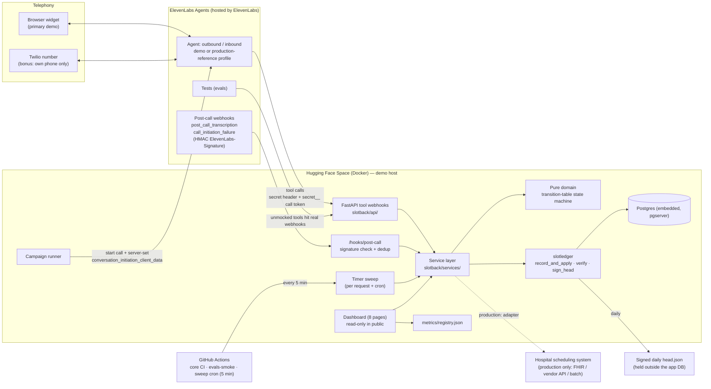
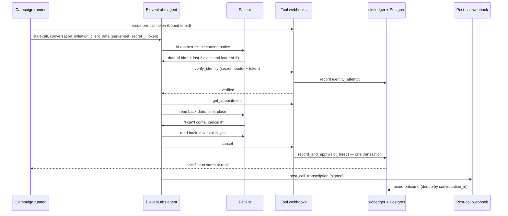
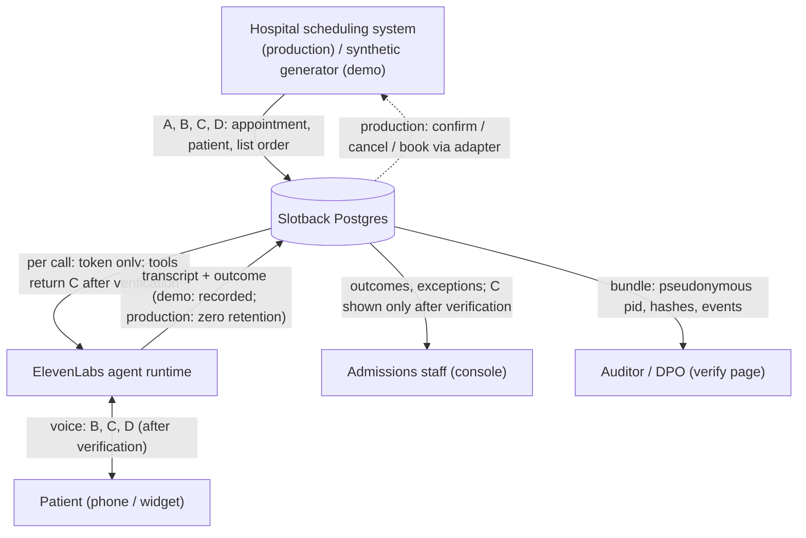

# 05 · Solution design

**Account:** a regional public health service in Spain · *Hospital General (fictional)*.
**Scope:** outbound confirm / cancel / reschedule plus waiting-list backfill (the pilot loop from `03_use_cases.md`), with inbound cancellation as the scale-path extension (E8).
**Status:** design for the prototype. All data is synthetic. Every Slotback performance figure in this document is a `{{metric:...}}` placeholder filled from `metrics/registry.json`, and carries its provenance tag (SIMULATED / SYNTHETIC / BENCHMARK / MEASURED).
**Source of truth for decisions:** `docs/designs/slotback-full-build.md` (D5–D28, E1–E8, OV1–OV8, ENG 1A–4B, EOV1–EOV8) and `docs/DECISIONS.md`. Decision IDs are cited inline.

---

## 1. Design principles

1. **The hospital's systems decide; the agent carries messages.** The agent never decides clinical priority and never reorders the waiting list. It offers a freed slot to rank 1, then rank 2, and so on, exactly as the hospital's list provides.
2. **Slots are freed only by a patient's cancellation or by staff.** Never by a predicted no-show (AI Act Annex III; see §9.1).
3. **Identity before detail.** Nothing about the appointment, including the specialty, is said before identity is verified (D13).
4. **Every change is recorded once, atomically.** The slot change and its ledger event are written in one transaction (D10).
5. **The ledger is evidence, not the bill.** The hospital's booking system is the source of truth. Billing counts only fills that match the hospital's own booking record (OV2, OV3).
6. **Safety rules are written once.** Prompt fragments compose every agent config, and a test checks each config has every fragment (2A).

---

## 2. Architecture

**Hosting split.** The agent (LLM, speech, voice) runs on ElevenLabs. Everything that holds appointment state runs in our container: in the demo, a Hugging Face Space with Postgres embedded in the same container via `pgserver` (decision of 2026-10-16: co-located, no third-party database account, restarts reseed deterministically). In production, the same container image runs inside the hospital's or an EU-resident host's environment (§8).

---

## 3. Components

| Component | Location | Responsibility | Key decisions |
|---|---|---|---|
| Agent configs | `agent/` | 4 configs composed from `agent/fragments/*`: outbound × inbound, each in `demo` and `production-reference` profiles. Pushed by `push.py`. Tool schemas generated from Pydantic models | 2A, 2B, D16 |
| Tool webhooks | `slotback/api/tools.py` | `verify_identity`, `get_appointment`, `confirm`, `cancel`, `list_alternative_slots`, `reschedule`, `offer_backfill`, `accept_backfill`, `transfer_to_human`, `log_outcome`. Validate secret header and call token; return 422 errors the agent can read; never invent slots | D11, D14, D15 |
| Post-call webhook | `slotback/api/hooks.py` | Receives `post_call_transcription` and `call_initiation_failure`, checks the HMAC signature, deduplicates, feeds outcomes (completed, no answer, voicemail) into the state machine | EOV1 |
| Timer sweep | service layer + `.github/workflows/sweep.yml` | Expires 10-minute holds, advances backfill to the next rank, marks slots unfilled when out of time. Runs on every request and from a GitHub Actions cron every 5 min | EOV1 |
| Service layer | `slotback/services/` | Orchestrates domain + ledger + DB in one transaction per tool call; at most 2 DB round trips per tool | 1B, D10 |
| Domain | `slotback/domain/` | Pure, in-memory state machine as a transition table; fake clock injected; property-tested with Hypothesis | D19, D20, D22, EOV6 |
| `slotledger` | `packages/slotledger/` | Standalone package, no Slotback imports: `record_and_apply`, per-hospital-per-day hash chain, `verify`, `sign_head` (Ed25519), bundle export, `slotledger verify` CLI | D10, D27, 4B, E2 |
| Campaign runner | `slotback/services/` (campaign module; path indicative) | Builds the day's call list; one call per appointment per campaign day (unique key); calling window Mon–Sat 09:00–20:00 Europe/Madrid; max 2 attempts; demo allow-list = the developer's own phone only | D18, D8 |
| Dashboard | `slotback/dashboard/` | 8 pages (landing, impact, console, call detail, ROI, evals, verify, try). Public = read-only; actions behind the access code and logged | D17, D28, 3A |
| Metrics registry | `metrics/registry.json` | Every number with its provenance tag; dashboard reads it; docs and readout use `{{metric:...}}` placeholders; CI fails on stale or unfilled ones | 2C, D28 |
| Deploy check | `scripts/deploy_check.py` | Gates the agent push: health, seed counts, signed tool call, verifier, unsigned call rejected, tool p95 | D26 |
| Kill switch | console, behind access code | Stops the campaign runner and makes every tool return a "calling paused" response; banner shows who paused it and when | D17 |

### 3.1 Backfill state machine (D20)

The state machine is a transition table in `slotback/domain/`. Any move not in the table raises `IllegalTransition`. The diagram in `06_conversation_design.md` is generated from the same table, so docs and code cannot drift.

**Slot states** (`slots.status`): `booked`, `freed`, `offering`, `filled`, `unfilled`.

| From | Event | Guard | To | Ledger event |
|---|---|---|---|---|
| `booked` | `cancel` (patient, after read-back + explicit yes) | identity verified | `freed` | `slot_freed` |
| `booked` | `staff_release` | access code | `freed` | `slot_freed` |
| `freed` | `offer(r1)` | slot start > cut-off; list snapshot taken | `offering` | `list_snapshot`, `offer_started` |
| `offering` | `hold` (patient interested) | identity verified; hold ≤ 10 min | `offering` (held for rank r) | `hold_placed` |
| `offering` | `accept` | hold owned by this call; compare-and-swap on `version` succeeds | `filled` | `slot_filled` |
| `offering` | `decline` / `no_answer` / `voicemail` / `hold_expired` | next rank exists and time remains | `offering` (rank r+1) | `offer_declined` / `offer_no_answer` / `hold_expired`, `offer_started` |
| `offering` | `out_of_time` or list exhausted | — | `unfilled` | `slot_unfilled` |
| `freed` | `out_of_time` | — | `unfilled` | `slot_unfilled` |
| `filled` | `attended` (from hospital record; synthetic in demo) | matched to hospital booking | `filled` | `attended` |
| `filled` | `cancel` by the new patient | identity verified | `freed` | `slot_freed` (new backfill run) |

**Appointment statuses** (`appointments.status`): `scheduled`, `confirmed`, `cancelled`, `rescheduled`, `attended`, `no_show`.

| From | Event | To | Notes |
|---|---|---|---|
| `scheduled` | `confirm` | `confirmed` | After read-back of date, time and place |
| `scheduled` / `confirmed` | `cancel` | `cancelled` | Only after read-back and an explicit yes (D19); frees the slot |
| `scheduled` / `confirmed` | `reschedule` | `rescheduled` (old) + new `scheduled` | **Atomic swap** in one transaction: the patient always holds exactly one appointment, even if they hang up mid-swap (D19) |
| `scheduled` / `confirmed` | `attended` / `no_show` | `attended` / `no_show` | From the hospital record on the day; synthetic in the demo |

**Concurrency.** A claim uses `SELECT … FOR UPDATE` on the slot row plus a `version` compare-and-swap (E7). Two patients accepting the same slot: one wins, the other hears "that slot has just been taken" and is offered a staff callback. Writes lock that hospital-day's head row so the hash chain stays linear (4B).

### 3.2 The Backfill Ledger

- **What it records:** every state change above, every identity attempt (pass and fail, D13), every list snapshot used for an offer, and `attended` outcomes.
- **Chain:** one hash chain per hospital per day (4B). Each event stores the hash of the previous one. `record_and_apply()` writes the slot change and the event in one transaction (D10); a property test asserts the ledger and the slot table always agree.
- **Signed head:** at day close, the last hash is signed with Ed25519 into `head.json`, which is handed to the hospital and stored outside the app database. A missing signing key means the head is not signed and the UI shows an UNSIGNED banner (D14).
- **Bundle:** `ledger.jsonl` + `list_snapshots.jsonl` + `head.json`. `slotledger verify <bundle>` and the `/verify` page check the hash chain, the signed head, list order (offers went to ranks in order) and identity-before-detail. A ledger-only upload reports "list order: not checked (no snapshots)".
- **Persistence:** bundles are stored in Postgres; the showcase day's bundle is also committed under `evidence/` (OV6, EOV7).
- **What it does not prove (OV2).** A ledger signed by the vendor shows that the record was not rewritten after the hospital received the head. It does not prove the events were true. The hospital's booking system remains the source of truth, and billing reconciles against it daily (`04_business_case.md`).

### 3.3 Call lifecycle

---

## 4. Data flow and personal-data classification

| Class | Fields | GDPR category | Where it goes | Minimisation |
|---|---|---|---|---|
| **A · Identifiers** | `pid` (pseudonymous), name, ID number, date of birth | Personal data | DB; ID and DOB never sent to the LLM as context, only checked server-side in `verify_identity` | Agent receives a call token, not the pid; LLM-supplied pids are ignored (D15) |
| **B · Contact** | phone number, language preference | Personal data | DB → campaign runner → telephony | Demo uses non-dialable `+34 000` numbers; only the allow-listed own phone is dialled |
| **C · Appointment** | specialty, date, time, site, room | **Special category (Art. 9 health data)**: even the specialty reveals health information | DB → tool responses after verification → voice | Withheld until `verify_identity` succeeds; never on voicemail or to a third party |
| **D · Waiting-list position** | rank, specialty, referral date, priority band (`preferente` / `ordinaria`) | **Special category (Art. 9)** | DB; rank used by the backfill engine | Agent never reads out a rank or priority band; it only offers a slot |
| **E · Call content** | transcript, audio (demo only), tool calls | May contain Art. 9 data | ElevenLabs (processor) → post-call webhook → DB | `production-reference` profile: zero retention, no recording (Enterprise feature, §8) |
| **F · Operational logs** | pid, call_id, tool, outcome, latency | Pseudonymous personal data | JSON logs | A test fails if any other field appears in a log line (D24) |
| **G · Illustrative analytics** | `no_show_propensity`, `will_no_show` (synthetic) | Synthetic only | Demo simulation and analytics | Never used to free, order or offer a slot (§9.1) |

---

## 5. Security

| Control | How | Decision |
|---|---|---|
| Webhook authentication | Every tool request carries a workspace secret in `request_headers` (referenced by `secret_id`, never shown to the LLM). Missing or wrong secret → 401, nothing changes, rejection logged | D11 |
| Per-call token | Campaign runner issues a token bound to one patient and one call. For phone calls it is set server-side in `conversation_initiation_client_data` and sent to tools as a `secret__` dynamic-variable header | D15 |
| LLM cannot pick the patient | Any `pid` the LLM sends is ignored; the token decides. A token used against another patient's data → 403 | D15 |
| Bind-on-verify (widget and inbound) | Widget dynamic variables are set by the browser, so they are untrusted. Widget and inbound sessions start with an **unbound** token; only `verify_identity` works until it binds the token to the one patient it verified | 1C, EOV2 |
| Identity limits | Max 2 failed checks per call, then a callback message; 3 failed calls in 24 h lock automated calls for that patient and flag staff; lockout keyed on phone number + patient; every attempt in the ledger | D13 |
| Rate limits | `slowapi` per-IP limits on tool webhooks; `/verify` uploads 10/min per IP, 5 MB cap, schema-validated, never executed or rendered as raw HTML | D11, E2 |
| Post-call webhook | HMAC `ElevenLabs-Signature` checked; replayed events deduplicated by `conversation_id` | EOV1 |
| Public dashboard | Read-only. Kill switch, campaign start, callbacks and Try-it need the access code; every action logged with who and when | D17 |
| Secrets | `.env` locally (gitignored), HF and GitHub secrets in deployment; never in code | docs/PRINCIPLES.md |
| Dialling | Allow-list: in the demo the only dialable number is the developer's own phone, read from the environment | D8 |
| Signing key | Ed25519 key held as a secret; missing key → refuse to sign, UNSIGNED banner | D14 |

---

## 6. Failure modes

Merged from the two registries in the build plan. "Test" means an automated test exists or is planned for that path.

| Code path | Failure | Handling | Test | What the patient or staff see | Logged |
|---|---|---|---|---|---|
| `verify_identity` | Speech recognition mishears DOB or ID digits | Re-ask with digit-by-digit prompt; after 2 failures, callback message | Persona + widget voice tests (OV4) | Re-ask, then callback number | Yes |
| `verify_identity` | Brute force across calls | 24 h lockout after 3 failed calls, staff flag (D13) | Persona | Lockout; staff follow up | Yes |
| Any tool | Jailbreak asks for another patient | Token binding; foreign pid → 403 (D15) | Persona | "I can only discuss your own appointment" | Yes |
| `accept_backfill` | Compare-and-swap lost / hold expired | Slot not given twice; staff callback offered | Property test | "That slot has just been taken" | Yes |
| `record_and_apply` | Crash between slot write and ledger write | One transaction (D10); no partial state | Crash injection | Consistent state | Yes |
| `reschedule` | Hang-up mid-swap | Atomic swap (D19); patient keeps exactly one appointment | Persona + integration | Original or new appointment, never none | Yes |
| Campaign runner | Rerun or restart | Unique key per appointment per day (D18) | Property: run twice → one call | Nobody called twice | Yes |
| Tool webhook | Space asleep or response > 10 s | Filler phrase; apology + callback; wake script before demos | deploy_check | Apology + callback | Yes |
| Tool webhook | No or invalid secret | 401, nothing changes (D11) | deploy_check | — | Yes |
| Post-call webhook | Bad signature or replay | Reject 401; dedup | Unit | Nothing changes | Yes |
| Voicemail outcome | Voicemail does not fire `call_initiation_failure` | Read from transcript / termination reason / batch status; sweep advances backfill | Unit + persona | Callback-number-only message | Yes |
| Timer sweep | Space asleep, cron missed | Next request runs the sweep | Fake-clock unit | Hold expires late (≤ 5 min) | Yes |
| Eval runner | 429 / 5xx / quota / empty transcript | Retry 2× with backoff, then ERRORED; any ERRORED in smoke fails the gate (D12) | Unit | Evals page: amber "gate not green" | Yes |
| Eval isolation | Eval writes into the showcase day | One hospital ID per eval run; showcase read-only (EOV5) | After nightly run, showcase head hash unchanged | — | Yes |
| Leak detector | Misses a leak | Known-answer set must be 100% caught, ≤ 2 false alarms (D21) | CI | Gate fails | Yes |
| `sign_head` | Key missing | Refuse to sign (D14) | Unit | UNSIGNED banner | Yes |
| Boot / seed | Seed fails | Health check fails loudly (D14) | deploy_check | "Demo server didn't start" | Yes |
| Evidence | Restart wipes ledgers | Bundles in Postgres + `evidence/` (OV6) | deploy_check | Bundles persist | Yes |
| Billing | Fill not attended or no matching hospital booking | Not billable; shown in reconciliation (OV2, OV3) | Unit | Reconciliation row | Yes |
| Campaign | Kill switch pressed | Runner stops; tools answer "calling paused" | Playwright | Banner with who/when | Yes |
| Waiting list | Stale list (patient already seen, deceased) | Production: list snapshot refreshed before each run, staff-maintained exclusions; agent never argues with the list | Discovery check (02 §3) | Staff-handled exception | Yes |

---

## 7. Integration: FHIR R4 mapping (candidate)

**FHIR-shaped subset, not a certified server.** Per D5 this mapping is documented by default; FHIR-shaped endpoints over the service layer are a day-5 stretch. If built, read endpoints are public (synthetic data) and write endpoints sit behind the access code. In production the adapter would map to whatever the hospital's scheduling system exposes (FHIR, HL7 v2 via an integration engine, a vendor API or batch files), established in discovery (`02_discovery.md` §1.3).

| Slotback model | FHIR R4 resource | Fields (candidate mapping) | Notes |
|---|---|---|---|
| `slots` | `Slot` | `id` ← `slot_id`; `start` / `end` ← `starts_at` + `minutes`; `status`: `busy` (booked, filled), `free` (freed, offering), `busy-unavailable` (unfilled after cut-off); `serviceType` ← specialty; `schedule` → `Schedule` per room | `offering` and hold state are Slotback-internal; exposed via an extension if needed |
| `appointments` | `Appointment` | `id` ← `appointment_id`; `status`: `booked` (scheduled), `booked` + confirmation extension (confirmed), `cancelled`, `fulfilled` (attended), `noshow`; `slot` → `Slot`; `participant.actor` → `Patient`; `created` ← `booked_on`; `serviceType` ← specialty | Reschedule = old `cancelled` + new `booked`, written as one transaction (FHIR `Bundle` of type `transaction`) |
| `patients` | `Patient` | `id` ← `pid`; `name`; `birthDate`; `identifier` (ID number, masked in reads); `telecom` (phone); `communication.language` | Reads return only what the console needs; ID number never returned in full |
| `waitlist_entries` | `ServiceRequest` (referral) **or** `List` | `ServiceRequest`: `subject`, `authoredOn` ← `referred_on`, `priority` ← `routine`/`urgent` mapped from `ordinaria`/`preferente`; order carried by a `List` with `entry` in rank order | The order belongs to the hospital; Slotback reads it, snapshots it, never writes it |
| Ledger event | `AuditEvent` / `Provenance` (candidate) | `recorded`, `agent`, `entity` → Appointment/Slot | Optional; the hash chain stays in `slotledger` |

---

## 8. Demo vs production (D25)

The same table appears in the README, the DPIA and the readout.

| Aspect | Demo (this prototype) | Production (proposed) |
|---|---|---|
| Data | Synthetic only; IDs fail the DNI checksum; phones are non-dialable `+34 000` | Real patient data from the hospital's scheduling system |
| App hosting region | Hugging Face Space (free CPU); region not EU-guaranteed | Hospital-hosted or EU-resident host meeting ENS |
| Database | Postgres embedded in the Space container (`pgserver`), reseeded on restart | Hospital-hosted or EU-resident managed Postgres, backed up, ENS controls |
| ElevenLabs data residency | Not claimed | EU data residency is an **Enterprise** feature; required for production |
| Retention | `demo` profile: recording on, AI and recording notice | `production-reference` profile: Zero Retention Mode (Enterprise feature), no recording unless the DPO sets a retention period |
| Calling mode | Single calls to the developer's own phone | ZRM excludes batch calling, so production places calls **one at a time** from the campaign runner (concurrency managed by us) |
| Telephony | Browser widget (primary recorded demo); Twilio call to the developer's own allow-listed phone (recorded) | Hospital SIP trunk or a hospital-recognisable number (to agree with IT) |
| Identity factors | DOB + last 3 digits + letter of ID (synthetic) | Same, unless the DPO's phone-identity policy says otherwise |
| Integration | Mock scheduling API over synthetic data | Adapter to the hospital's scheduling system (FHIR / vendor API / integration engine / batch) |
| Ledger head | Ed25519-signed `head.json`, committed under `evidence/` | Signed head delivered daily to the hospital; billing reconciled against the hospital's booking record |
| Results | All performance numbers SIMULATED (e.g. <!--m:recovered_slots-->14<!--/m--> SIMULATED) | MEASURED in the pilot against the SMS-only arm |

---

## 9. Compliance

| Obligation | How the design meets it | Owner |
|---|---|---|
| **Legal basis:** GDPR Art. 6.1.e (public task) and Art. 9.2.h (health care management) | Calls are care communications by the hospital to its own patients, not marketing; no consent required. Opt-out of automated calls still offered | Hospital (controller) |
| **LOPDGDD 3/2018** | Applies alongside GDPR; DPO involvement; duty of confidentiality on processor staff | Hospital + vendor |
| **Ley 41/2002** (patient autonomy and clinical information) | Information about care given only to the patient or an authorised person; hence identity before detail and nothing to third parties | Hospital |
| **Processor agreement, GDPR Art. 28** | Vendor and sub-processors (voice platform, telephony, hosting) under a DPA; sub-processor list disclosed | Vendor |
| **DPIA, GDPR Art. 35** | Draft in `05b_dpia_draft.md`; signed off by the hospital's DPO before the pilot | Hospital DPO |
| **ENS (Esquema Nacional de Seguridad, RD 311/2022)** | Category to be set with the hospital's security lead; controls: access control, logging, encryption in transit, incident management, supplier conformity | Vendor + hospital IT |
| **AI Act Art. 50 (transparency)** | AI disclosure is the first line of every call, in the patient's language. Application date stated in project sources as 2 Aug 2026 — **to verify** before any proposal relies on it (`OPEN_QUESTIONS.md` #4) | Vendor (provider) + hospital (deployer) |
| **Recording notice and retention** | Patient told the call is recorded (demo); production default is no recording, or a DPO-set retention period | Hospital DPO |
| **Right to a human** | `transfer_to_human` or a staff callback whenever the patient asks; opt-out recorded in `patients.opted_out` | Hospital |

### 9.1 Why this stays out of AI Act Annex III

Annex III lists, among high-risk uses, AI systems used by public authorities to evaluate eligibility for, or access to, essential public services including healthcare. The design keeps every access decision with the hospital:

1. **Slots are freed only by a cancellation or by staff.** A cancellation is the patient's own decision, confirmed by read-back and an explicit yes (D19). The system never frees a slot because it predicts a no-show.
2. **Offers follow the hospital's list order strictly.** The backfill engine offers rank 1, then rank 2, and so on. A list snapshot is taken before each run, and `/verify` checks that offers followed it.
3. **The agent never decides priority.** It never reads, reorders or comments on the `preferente` / `ordinaria` band. Clinical urgency stays with clinicians.
4. **No clinical advice.** Medical questions get a scripted refusal and a route to a human (`06_conversation_design.md`).
5. **The illustrative `no_show_propensity` column is analytics only.** It exists in the synthetic generator to make the demo day realistic (signs follow [S2b]; coefficients illustrative). It must never be read by the campaign runner, the backfill engine or the agent. Proposed control: a code-level test that fails if those modules reference it (not yet in the task list).

This is our reading for design purposes, not legal advice. The hospital's legal team should confirm it.

---

## 10. Observability

- **Trace ID:** the ElevenLabs `conversation_id` is used on logs, ledger events and call records (D24).
- **Logs:** JSON, with only `pid`, `call_id`, `tool`, `outcome`, `latency_ms`. Enforced by a test.
- **Latency budget:** tool p95 ≤ 300 ms server time (design target, D23). Current value: <!--m:tool_latency_p95_ms-->0.9 ms (measured locally)<!--/m--> (measured locally through the API with embedded Postgres by `scripts/fill_metrics.py`; `deploy_check` re-measures on the hosted demo). The agent says a short filler phrase on slow tools.
- **Console alerts (4):** privacy flag on a call; transfer spike; webhook error rate > 5%; tool p95 > 300 ms. Runbook in `10_operations.md`.
- **Gate:** deterministic eval gate (ledger verifier, leak detector, tool-call correctness, AI disclosure, read-back) blocks an agent push; ElevenLabs built-in evaluation is advisory (D9). Detail in `08_evals.md`.

---

## 11. Open points

| # | Point | Resolves it |
|---|---|---|
| 1 | AI Act Art. 50 application date | Check before the readout states it |
| 2 | Hospital scheduling system interface (FHIR, HL7 v2, vendor API, batch) | IT discovery session |
| 3 | ENS category and supplier conformity requirements | Hospital security lead |
| 4 | Whether the DPO accepts DOB + last 3 digits + letter as phone identity | DPO session |
| 5 | Production concurrency without batch calling (one-at-a-time calls) and its effect on calling-window capacity | Pilot sizing in `09_pilot_plan.md` |
