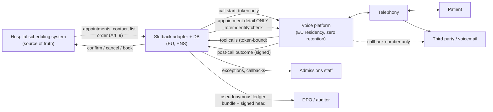

> **BORRADOR – hospital ficticio – no constituye asesoramiento jurídico**
> *DRAFT – fictional hospital – not legal advice.* This document illustrates the DPIA a hospital's data protection officer would review before a pilot. The controller, the hospital and all data are fictional or synthetic.

# 05b · Evaluación de impacto relativa a la protección de datos (EIPD) · DPIA draft

**Controller (responsable):** *Hospital General (fictional)*, part of a regional public health service in Spain.
**Processor (encargado):** the Slotback vendor, with sub-processors for the voice platform, telephony and hosting.
**Processing:** outbound automated voice calls to confirm, cancel or reschedule specialist outpatient appointments, and to offer freed slots to patients on the waiting list in the hospital's order.
**Legal requirement:** GDPR Art. 35 (large-scale processing of special-category data, Art. 9; new technology).
**Structure:** follows the general structure of the Spanish data protection authority's (AEPD) guidance on risk management and DPIA (2021 — to verify exact title and edition before use).
**Version:** 0.1 · 2026-10-16 · for DPO review.
**Companion documents:** `05_solution_design.md` (architecture and controls), `06_conversation_design.md` (call flows), `09_pilot_plan.md` (pilot), `docs/designs/slotback-full-build.md` (decision IDs cited below as D#, OV#, EOV#).

---

## 1. Descripción del tratamiento · Description of the processing

### 1.1 Purpose

1. Remind patients of upcoming specialist appointments and let them confirm, cancel or reschedule in the same call.
2. When a slot is freed by a cancellation or by staff, offer it to patients on the waiting list **strictly in the order the hospital's list provides**, until it is filled or it is too late to fill.
3. Hand off to admissions staff anything clinical, sensitive, unclear, or any request for a human.

**Explicitly not a purpose:** predicting no-shows to free slots; deciding clinical priority; giving clinical advice; marketing.

### 1.2 Data subjects

| Group | Approx. volume (synthetic profile) | Notes |
|---|---|---|
| Patients with a booked specialist appointment in the pilot specialty | Pilot specialty share of 380,000 appointments/year (SYNTHETIC, `01_account_brief.md` §2.5) | Includes elderly, hard-of-hearing and non-Spanish-speaking patients |
| Patients on the pilot specialty's waiting list | Per specialty | Contacted only when a slot is offered |
| Third parties who answer the phone (relatives, carers, wrong numbers) | Unknown | Receive no health information |
| Admissions staff using the console | Pilot team | Access logged; not performance-monitored (§4, R12) |

### 1.3 Categories of data

| Category | Fields | Art. 9? |
|---|---|---|
| Identifiers | pseudonymous patient ID, name, national ID number, date of birth | No (but used to protect Art. 9 data) |
| Contact | phone number, preferred language | No |
| Appointment | specialty, date, time, site | **Yes** — the specialty alone reveals health information |
| Waiting-list position | rank, referral date, priority band | **Yes** |
| Call content | transcript, audio (only if recording is enabled), tool calls, outcome | May contain Art. 9 data the patient volunteers |
| Operational logs | pseudonymous ID, call ID, tool, outcome, latency | No (pseudonymous) |
| Staff | console user, actions taken (kill switch, callback) | No |

### 1.4 Recipients and processors (roles, not vendor claims)

| Role | Function | Location (production requirement) |
|---|---|---|
| Hospital admissions staff | Handle escalations, callbacks, exceptions | Hospital |
| Slotback vendor (processor) | Runs tool webhooks, backfill engine, ledger, console | EU, ENS-conformant hosting |
| Voice-agent platform (sub-processor) | Speech recognition, language model, speech synthesis during the call | EU data residency and zero retention required (Enterprise features of the platform considered; to confirm in contract) |
| Telephony provider (sub-processor) | Carries the call | To agree with hospital IT (hospital SIP trunk preferred) |
| Hosting provider (sub-processor) | Runs the container and database | EU |

No data is transferred outside the EU in production. The **demo** runs on non-EU-guaranteed hosting with synthetic data only (see §3 and the demo-vs-production table in `05_solution_design.md` §8).

### 1.5 Retention

| Data | Proposed retention | Basis |
|---|---|---|
| Call audio | **Not recorded** in production by default. If the DPO requires recording: period set by the DPO, then deleted | Minimisation |
| Transcripts at the voice platform | Zero retention (production-reference profile, D16) | Minimisation |
| Transcripts and outcomes in Slotback | Period set by the DPO (proposal: 90 days for QA sampling, then outcome only) | QA, incident investigation |
| Ledger events (pseudonymous) | Length of the contract + audit period, as billing evidence | Billing reconciliation (OV2, OV3) |
| Operational logs | 30 days (proposal) | Security |
| Opt-out flag | While the patient is registered | Respecting the patient's choice |

---

## 2. Necesidad y proporcionalidad · Necessity and proportionality

### 2.1 Legal basis

- **GDPR Art. 6.1.e** — performance of a task in the public interest (provision of public healthcare).
- **GDPR Art. 9.2.h** — processing necessary for the management of health care services, under the responsibility of professionals bound by secrecy.
- **LOPDGDD 3/2018** and **Ley 41/2002** (patient autonomy; information given to the patient or an authorised person).
- These are **care communications**, not marketing; consent is not the legal basis. An opt-out from automated calls is nonetheless offered (§5).

### 2.2 Necessity: why voice and not only SMS

The reference study in other regions concludes SMS is the most cost-effective fix for forgetting (BENCHMARK [S2, 2013–14]). The processing is proportionate only for what SMS cannot do:

| Need | SMS | Voice agent |
|---|---|---|
| Remind | Yes | Yes |
| Take a cancellation there and then | No (one-way, or link) | Yes |
| Reschedule | No | Yes |
| Offer a freed slot to the next patient within hours | No | Yes |
| Reach patients who do not read SMS or links | Limited | Yes |

The pilot runs SMS-only as a control arm (`09_pilot_plan.md`), so necessity is tested, not assumed.

### 2.3 Minimisation

- Identity verified (date of birth + last 3 digits and letter of the ID) **before** any detail, including the specialty (D13).
- The language model never receives the national ID or date of birth as context; they are checked server-side.
- The agent works through a per-call token bound to one patient; it cannot request another patient's data (D15).
- Voicemail and third parties: callback number only.
- Logs contain only pseudonymous ID, call ID, tool, outcome and latency (D24).
- Waiting-list rank and priority band are never spoken.

### 2.4 Alternatives considered

| Alternative | Why not chosen |
|---|---|
| More staff calls | Effective but capacity-limited; this is the status quo constraint |
| SMS only | Cannot refill a freed slot; kept as the control arm |
| App notifications | Poor reach for elderly and rural patients (BENCHMARK [S3, 2021], context only) |
| Predict no-shows and overbook / free slots | Rejected: AI deciding access to public healthcare (AI Act Annex III) and higher intrusion |
| Recording all calls | Rejected as default; zero retention unless the DPO requires recording |

---

## 3. Flujo de datos · Data flow

**Demo deviation:** the demo uses synthetic data, a mock scheduling system, non-EU-guaranteed hosting, and recording enabled with notice (demo profile, D16). No real personal data enters the demo.

---

## 4. Registro de riesgos · Risk register

Scale: likelihood (L) and impact (I) from 1 (low) to 4 (very high). Inherent score = L × I before controls. Residual is the assessed level after controls: **Low** (1–3), **Medium** (4–6), **High** (8–16). Residual levels are draft judgements for DPO review, not measured values.

| ID | Risk | L | I | Inherent | Mitigations (controls) | Residual |
|---|---|---|---|---|---|---|
| R1 | Health detail disclosed to a third party who answers (relative, colleague) | 3 | 4 | 12 | Identity before detail (D13); third-party flow gives callback number only; specialty withheld; eval persona "relative answers"; leak detector, zero tolerance (D21) | Low |
| R2 | Health detail left on voicemail | 3 | 4 | 12 | Voicemail flow = callback number only; voicemail outcome read from transcript/termination reason; leak detector over voicemail scenarios | Low |
| R3 | Impersonation or brute force of identity factors | 2 | 4 | 8 | Max 2 failures per call; 3 failed calls in 24 h → lockout + staff flag; every attempt in the ledger (D13) | Low |
| R4 | Speech recognition mishears DOB / ID → wrong rejection (access barrier) or wrong acceptance | 3 | 3 | 9 | Digit-by-digit re-ask; server-side exact match (no fuzzy acceptance); failure → human callback; widget voice tests of the identity step (OV4) | Medium |
| R5 | Prompt injection / jailbreak to obtain another patient's data | 2 | 4 | 8 | Per-call token bound to one patient; LLM-supplied IDs ignored; foreign ID → 403 (D15); widget/inbound sessions unbound until verified (1C); injection persona in evals | Low |
| R6 | International transfer (sub-processor or demo host outside the EU) | 2 | 4 | 8 | Production requires EU residency and zero retention (Enterprise features, contractually confirmed); demo uses synthetic data only; sub-processor list in the DPA | Low (production) |
| R7 | Excessive retention of recordings or transcripts | 3 | 3 | 9 | Production-reference profile: zero retention, no recording (D16); DPO-set retention for Slotback transcripts; deletion job | Low |
| R8 | Breach at the vendor or a sub-processor | 2 | 4 | 8 | Art. 28 DPA; ENS controls (access control, encryption in transit, logging, incident management); secrets in host env only; secret header on webhooks (D11); minimal logs | Medium |
| R9 | Stale waiting list: slot offered to a patient already seen, transferred or deceased | 2 | 4 | 8 | List snapshot refreshed from the hospital system before each backfill run; staff-maintained exclusions; data-quality check in discovery; agent never argues with the list; incident runbook | Medium |
| R10 | Accessibility / discrimination: elderly, hard-of-hearing or non-Spanish speakers served worse | 3 | 3 | 9 | Slow, plain speech; repeat on request; ES/EN with RO/AR as stretch; human handoff always available; elderly and language-switch personas in evals; pilot monitors outcomes by age band | Medium |
| R11 | Patient perceives an automated decision about their care (Art. 22) | 2 | 3 | 6 | No access decision is automated: slots freed only by patient or staff, offers strictly in list order, no prioritisation (Annex III argument, `05` §9.1); AI disclosure first; human on request | Low |
| R12 | Console used to monitor staff performance | 2 | 2 | 4 | No per-staff metrics; works council consulted; console shows patient outcomes, not staff productivity | Low |
| R13 | Personal data leaking into logs or analytics | 2 | 3 | 6 | Log schema restricted to pseudonymous ID, call ID, tool, outcome, latency; enforced by a test (D24) | Low |
| R14 | Kill switch fails or is unavailable during an incident | 1 | 4 | 4 | Kill switch behind access code, logged (D17); stops runner and makes tools answer "calling paused"; tested in the browser smoke suite; agent can also be disabled at the platform | Low |
| R15 | Agent invents a slot or confirms a booking that does not exist | 2 | 3 | 6 | Agent can offer only slots returned by tools; 422 errors the agent can read; read-back before every change; atomic swap on reschedule (D19); ledger ⇔ slot property test (D10) | Low |

**Highest residual risks:** R4, R8, R9, R10 (Medium). These carry the action items in §7.

---

## 5. Derechos de los interesados · Data subject rights

| Right / safeguard | How it is exercised |
|---|---|
| Information (Arts. 13–14) | AI disclosure and (if applicable) recording notice at the start of each call; hospital privacy notice updated to describe automated reminder calls |
| Human contact | The patient can ask for a person at any time; `transfer_to_human` or staff callback |
| Opt-out of automated calls | Said during any call or via admissions; recorded as `opted_out`; campaign runner skips the patient; reminders fall back to the existing channel |
| Access, rectification, erasure, restriction | Through the hospital's existing data-protection channel; vendor assists as processor (Art. 28.3.e) |
| Objection (Art. 21) | Handled by the hospital; opt-out above covers automated calls |
| Not subject to solely automated decisions (Art. 22) | No access decision is automated (R11) |

---

## 6. Consultas · Consultation

| Party | Purpose | When |
|---|---|---|
| Data protection officer (DPD) | Review this draft, set retention, approve identity factors and scripts | Before build freeze |
| Information security / ENS lead | ENS category, supplier conformity, network access | Before pilot contract |
| Works council (junta de personal / comité de empresa) | Staff role changes, no performance monitoring | Before pilot start |
| Patient advocate / patient services unit | Script review, accessibility, test calls | Before pilot start |
| Clinical head of the pilot specialty | Confirm no clinical content; escalation routes | Before pilot start |
| Supervisory authority (prior consultation, Art. 36) | Only if a high residual risk remains after controls | If needed |

---

## 7. Plan de acción y aprobación · Action plan and sign-off

| # | Action | Addresses | Owner (role) | Due |
|---|---|---|---|---|
| A1 | Confirm EU residency and zero retention in the voice-platform contract | R6, R7 | Vendor | Before contract |
| A2 | Signed Art. 28 DPA with sub-processor list | R6, R8 | Vendor + hospital legal | Before contract |
| A3 | Voice test of identity step with elderly volunteers (synthetic identities) | R4, R10 | Vendor + patient advocate | Pilot week 1–2 |
| A4 | Waiting-list data-quality check and refresh procedure | R9 | Hospital IT + admissions | Before pilot start |
| A5 | Update hospital privacy notice | §5 | Hospital DPO | Before pilot start |
| A6 | Outcome monitoring by age band and language during the pilot | R10 | Vendor + admissions | Monthly |
| A7 | Review this DPIA at day 45 and day 90 of the pilot | All | DPO | Pilot milestones |

| Role | Name | Decision | Signature | Date |
|---|---|---|---|---|
| Data protection officer (DPD) | | ☐ Approve ☐ Approve with conditions ☐ Reject | ____________ | ________ |
| Hospital director (controller's representative) | | ☐ Approve ☐ Reject | ____________ | ________ |
| Information security / ENS lead | | ☐ Approve ☐ Reject | ____________ | ________ |
| Vendor (processor) representative | | Acknowledged | ____________ | ________ |

---

> **BORRADOR – hospital ficticio – no constituye asesoramiento jurídico**
