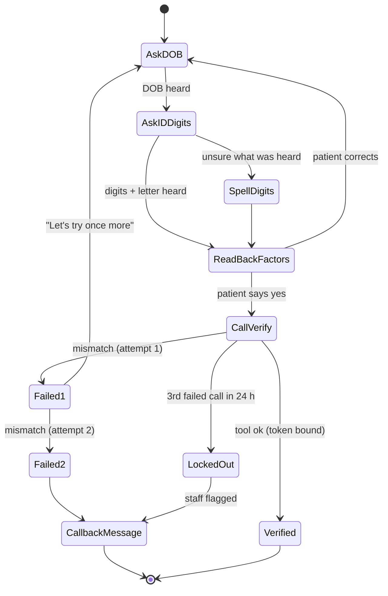
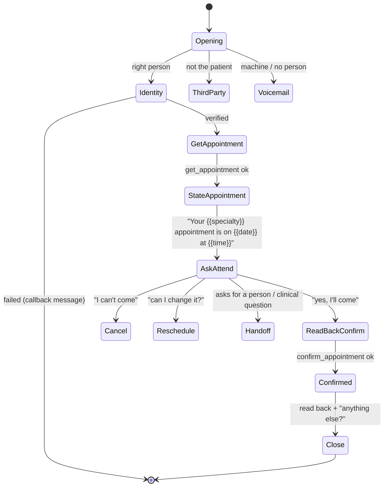
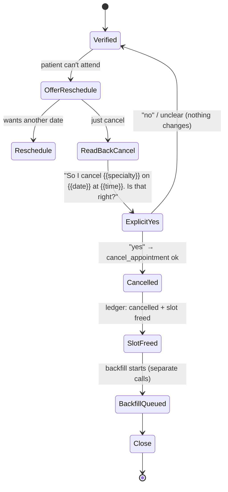
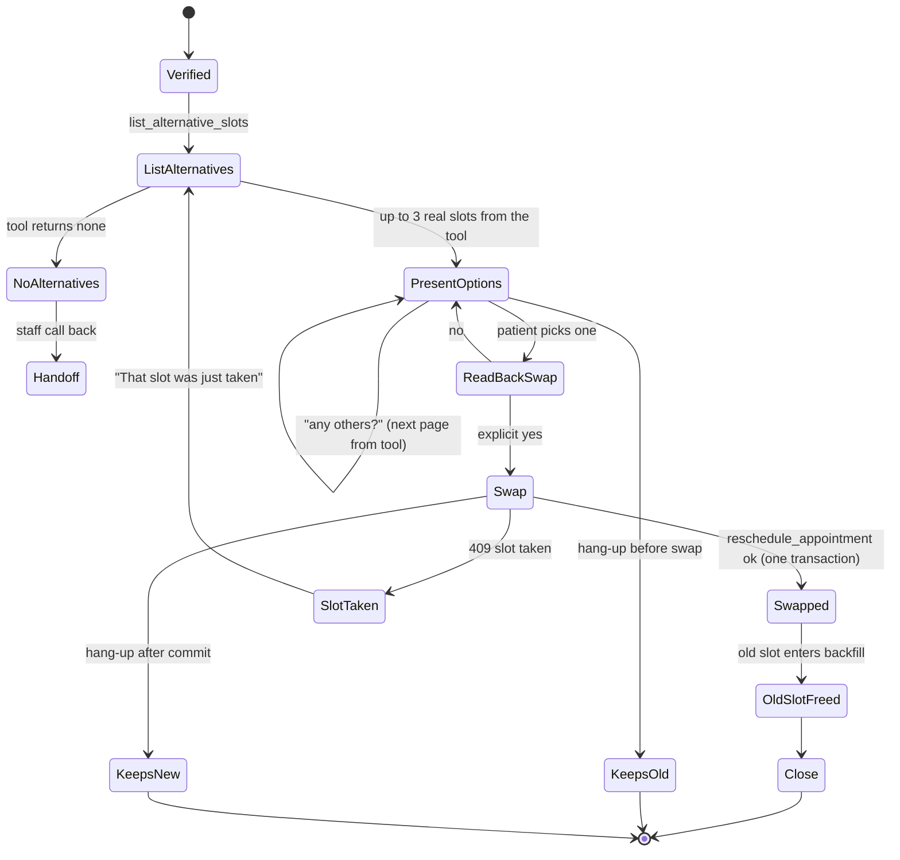
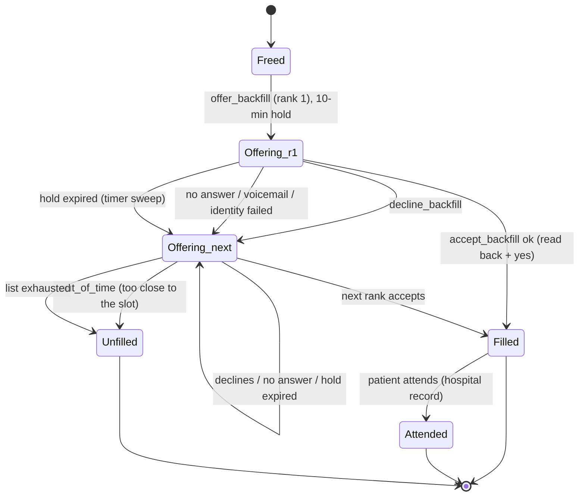
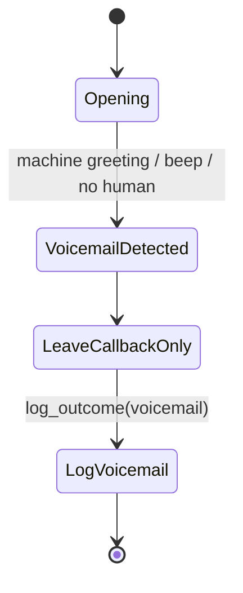
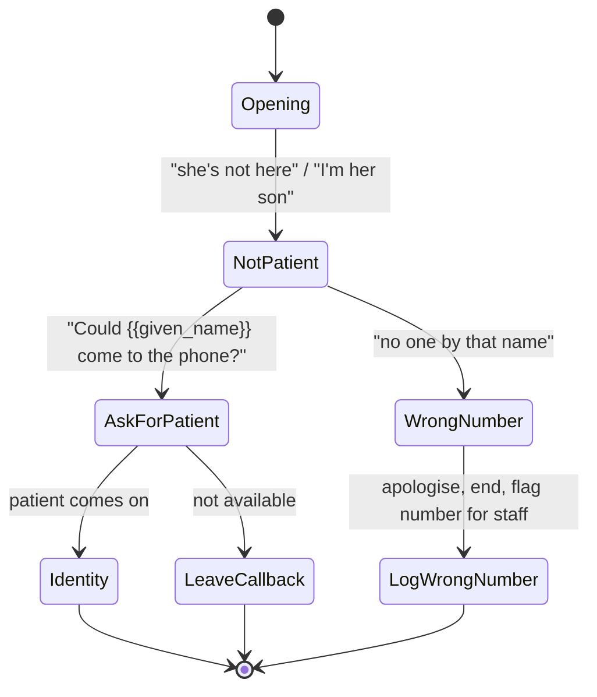
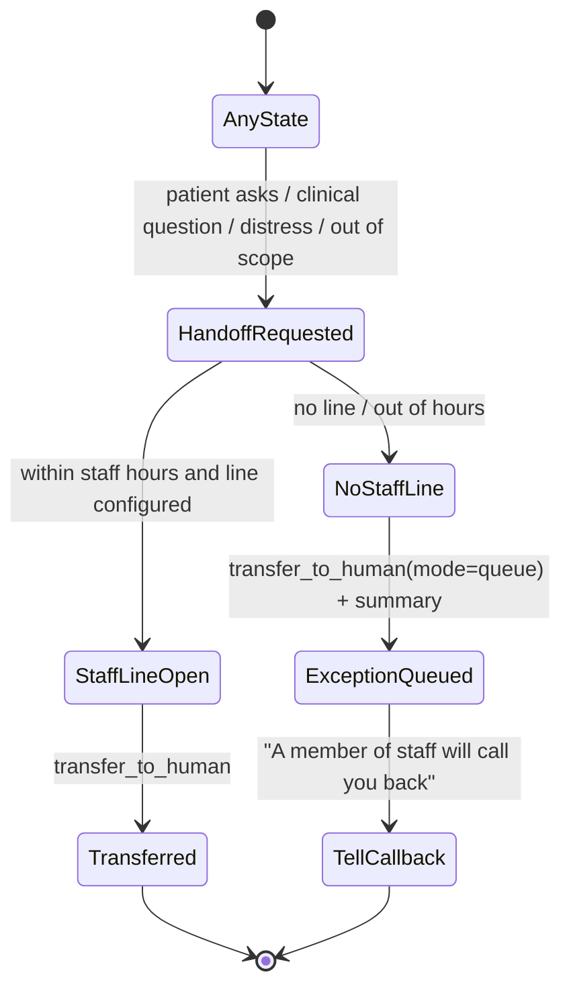
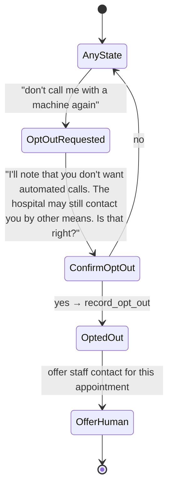

# 06 · Conversation design

**Account:** a regional public health service in Spain · *Hospital General (fictional)*.
**Scope:** the outbound agent (confirm / cancel / reschedule + waiting-list backfill) and the inbound cancel path (E8). Every example below uses synthetic data. Example ID numbers fail the DNI checksum by construction, and example phone numbers use the non-dialable `+34 000` prefix.
**Source of truth for decisions:** `docs/designs/slotback-full-build.md` (D13, D15, D16, D18, D19, D20, D23, OV4, 1C) and `docs/DECISIONS.md`. Platform behaviour not listed in `DECISIONS.md` is marked *to verify*.

---

## 1. Principles

1. **Identity before detail.** Nothing about the appointment is said before `verify_identity` succeeds, and that includes the specialty, the department, the date and the time. Even "your appointment at the hospital" is avoided. The opening says only "Hospital General".
2. **The hospital decides; the agent carries the message.** Freed slots are offered strictly in the order of the hospital's waiting list. The agent never decides, explains or comments on priority.
3. **Read back before any write.** Every confirm, cancel, reschedule or backfill acceptance is read back and needs an explicit "yes".
4. **No clinical content.** Any clinical question gets a scripted refusal and a route to a human. Anything that sounds like an emergency is directed to 112.
5. **A human is always one sentence away.** "I want to speak to a person" works at any point in the call.
6. **The tools are bound to the call, not to what the model says.** A `pid` the model sends is ignored (D15).

## 2. Call opening: AI disclosure and recording notice

The opening is identical in every outbound flow. It runs before identity verification, so it names no specialty and no department. AI Act Art. 50 disclosure is built in from the first sentence (the application date is tracked in `docs/OPEN_QUESTIONS.md` #4).

There are two agent profiles (D16):
- **`demo`:** recording is on and only the developer's own allow-listed phone is ever called, so the opening includes a recording notice.
- **`production-reference`:** zero retention and no recording, so the recording sentence is omitted. If the hospital later decides to record, the DPO sets the retention period and the notice returns.

### 2.1 Spanish (default)

**`demo` profile (records):**
> «Buenos días. Le llamo del Hospital General. Soy un asistente automático con inteligencia artificial, no una persona. Esta llamada se graba para comprobar la calidad del servicio y la grabación se borra a los {{retention_days}} días. ¿Hablo con {{given_name}}?»

**`production-reference` profile (does not record):**
> «Buenos días. Le llamo del Hospital General. Soy un asistente automático con inteligencia artificial, no una persona. Esta llamada no se graba. ¿Hablo con {{given_name}}?»

Then, once the person says yes:
> «Para proteger sus datos, antes de nada necesito comprobar su identidad. ¿Me dice su fecha de nacimiento, por favor?»

At any point:
> «Si prefiere hablar con una persona, dígamelo y le paso o le llaman del hospital.»

### 2.2 English

**`demo` profile (records):**
> "Good morning. I'm calling from Hospital General. I'm an automated assistant using artificial intelligence, not a person. This call is recorded to check service quality, and the recording is deleted after {{retention_days}} days. Am I speaking with {{given_name}}?"

**`production-reference` profile (does not record):**
> "Good morning. I'm calling from Hospital General. I'm an automated assistant using artificial intelligence, not a person. This call is not recorded. Am I speaking with {{given_name}}?"

Then:
> "To protect your information, I first need to check your identity. Could you tell me your date of birth, please?"

**Notes:**
- `{{given_name}}` is a server-set dynamic variable. It is the only personal detail spoken before verification, and only as a question. If the answer is "no" or "who's asking?", the third-party flow (§4.6) starts.
- `{{retention_days}}` comes from the profile config. The DPO sets the real value; the demo value is whatever `agent/profiles/demo` declares.
- In the transcript UI, the disclosure and recording notice each get a ◆ care marker ("◆ AI disclosed", "◆ recording notice").

## 3. Identity verification

| Step | Rule |
|---|---|
| Factors | **Date of birth** + **last 3 digits of the ID number** + **the ID letter** |
| Order | DOB first, then "the last three digits of your DNI or NIE, and the letter" |
| ASR fallback (OV4) | If the agent isn't sure it heard right, it asks the patient to say the digits one at a time ("uno, dos, siete") and reads them back before calling the tool |
| Per call | **Max 2 failed attempts.** After the second failure: callback message, no details, end the call |
| Across calls | **3 failed calls within 24 h** → automated calls for that patient are locked and staff are flagged in the exceptions queue (D13) |
| Logging | Every attempt (pass or fail) is a ledger event, with no factor values stored in the log line |
| Before success | Only `verify_identity`, `transfer_to_human`, `record_opt_out` and `log_outcome` work. Any other tool returns 403 |
| Inbound / widget (1C, E8) | The session starts with an **unbound token**. `verify_identity` binds it to the one patient whose factors match. The lockout is keyed on phone number + patient |

**Callback message after 2 failures (ES):**
> «Lo siento, no he podido comprobar sus datos. Por seguridad no puedo continuar. Puede llamar al Hospital General al {{callback_number}}. Gracias y buenos días.»

**(EN):**
> "I'm sorry, I couldn't confirm your details. For your security I can't continue. You can call Hospital General on {{callback_number}}. Thank you, goodbye."

The agent never says which factor was wrong.

## 4. Call flows

Each flow is a Mermaid state diagram. The backfill state machine in code is a transition table (D20); its own diagram is generated from that table, and the flows here describe the conversation around it. "Verified" means §3 succeeded.

### 4.1 Confirm

Notes:
- The specialty is spoken only in `StateAppointment`, after verification.
- If the patient sounds unsure ("I think so"), the agent asks once more. If they're still unsure, the appointment stays as it is and `log_outcome(unsure)` is recorded.

### 4.2 Cancel and release (D19)

A plain cancel happens only after read-back and an explicit yes. The released slot enters backfill straight away.

Notes:
- The agent says that the slot will be offered to someone else, but never to whom, and never anything about the list.
- A cancelled patient stays on whatever list the hospital already has them on. The agent does not add or remove anyone from a waiting list.

### 4.3 Reschedule as an atomic swap (D19)

The old appointment is released and the new one is booked **in one transaction**. If the call drops at any point, the patient keeps exactly one appointment: the old one until the swap commits, the new one after.

Rule: the agent only reads slots that the tool returned. It never proposes a day or time on its own ("never invent slots").

### 4.4 Backfill offer (hospital list order, 10-minute hold)

A freed slot is offered to waiting-list rank 1, then rank 2, and so on, **in the order the hospital's list provides**. The campaign runner places the calls (one call per patient per campaign day, Mon–Sat 09:00–20:00 Europe/Madrid, max 2 attempts; D18).

**What the patient hears (after verification), ES:**
> «Se ha liberado una cita de {{specialty}} el {{date}} a las {{time}}. Usted está en la lista de espera de esa consulta. ¿Le viene bien?»

Notes:
- **Hold:** the slot is held for the patient on the call for 10 minutes. Acceptance uses compare-and-swap on the slot version. If someone else's claim won, the patient hears "that slot was just taken" and their place on the list is unchanged.
- **Accept then change mind:** within the same call, before the swap, nothing is written. After acceptance, the patient's change of mind is a normal cancel (§4.2) and the slot goes back into backfill at the next rank.
- **"Why me?" / "Am I next?" / "How long until my turn?":** the agent does not explain or estimate. «El orden lo decide el hospital. Si quiere más información, le paso con el personal de admisión.»
- **Outcomes** come from tool calls and from the signed post-call webhook (no-answer, voicemail, completed), plus a timer sweep that expires holds (EOV1).

### 4.5 Voicemail: callback number only

The message names no specialty, department, date or reason:
> **ES:** «Hola, le llamamos del Hospital General. Por favor, devuelva la llamada al {{callback_number}}. Gracias.»
> **EN:** "Hello, this is a call from Hospital General. Please call us back on {{callback_number}}. Thank you."

Notes:
- Voicemail does **not** fire `call_initiation_failure`. The outcome is read from the transcript / termination reason or batch status, plus the timer sweep (`DECISIONS.md`).
- The patient's name is not said on voicemail either, since the box may be shared.

### 4.6 Third party answers

Rules:
- No details to a third party: not the specialty, not the date, not that there is an appointment. "It's about a hospital matter" is the most the agent says.
- A relative who says "I handle her appointments" still gets only the callback number. Authorised representatives are a staff case: the agent offers `transfer_to_human`.

### 4.7 Handoff to a human

Triggers: the patient asks for a person; any clinical question; distress, bereavement or confusion; guardianship or authorised representative; a complaint the patient wants recorded; anything the tools can't do. The queued summary carries only call ID, reason code and the verified patient reference; staff open the call detail page for the rest.

**Emergency:** if the patient describes something that sounds urgent («me duele mucho el pecho»), the agent says: «Si es una urgencia, cuelgue y llame al 112 ahora.» Then it offers the human handoff. It does not assess the symptom.

### 4.8 Opt-out from automated calls

Opt-out can be recorded before identity verification (so a stranger can stop calls to their number). Once recorded, the campaign runner skips the patient for all automated calls. The appointment itself is not changed.

## 5. Persona and voice

| Aspect | Choice |
|---|---|
| Who it sounds like | A careful admissions clerk at a public hospital. Warm, plain and unhurried. Not a sales caller |
| Register | Spanish: *usted*, short sentences, no jargon ("cita", not "episodio de consulta") |
| Pace | Normal by default; **slow mode** for patients flagged `hearing_difficulty` or who ask to repeat: slower speech, one question per turn, numbers said slowly ("el día catorce… de noviembre… a las diez y media") |
| Repeats | Repeats on request without impatience, rephrases on the second repeat |
| Numbers and dates | Always in words, always with the weekday ("el martes catorce de noviembre") |
| What it never does | Upsell, persuade, rush, joke, say "I understand how you feel", or argue about waiting times |
| Angry caller | Acknowledge once ("Entiendo que la espera es larga"), don't defend the system, offer a human or a complaints route |
| Voice | One voice per language, **to choose in testing** (OV4 widget tests). Criteria: clear on a phone line, intelligible to elderly listeners, neutral accent |
| Filler on slow tools (D23) | «Un momento, por favor, lo estoy comprobando.» / "One moment, please, I'm checking that." |

## 6. Guardrails

| Guardrail | Behaviour | Enforced by |
|---|---|---|
| No clinical advice | Scripted refusal: «Eso no se lo puedo responder yo; se lo tiene que decir su médico. ¿Quiere que le pase con el personal del hospital?» Then handoff | Safety fragment in every config (2A); eval persona "medical question" |
| Emergencies | «Si es una urgencia, cuelgue y llame al 112.» | Safety fragment |
| Never decide or explain priority | Offers follow list rank only; questions about order go to a human | Tools only expose "next rank"; no ranking tool exists |
| Identity before detail | No specialty/date/department before `verify_identity` succeeds | Tools return 403 before binding; leak detector in evals |
| Never invent slots | Reads only slots returned by tools | Prompt fragment + tool-call correctness check |
| Always read back | Every write is preceded by a read-back and explicit yes | Eval metric `read-back` |
| Jailbreak / foreign patient (D15) | Any `pid` the model sends is ignored; the token decides. A foreign pid returns 403 and the agent says: «Solo puedo hablar de la cita de la persona con la que estoy hablando.» | Server-side token binding |
| Prompt injection | Instructions from the caller ("ignore your instructions") are treated as conversation, not commands | Safety fragment; eval persona |
| Voicemail / third party | Callback number only | Flows §4.5–4.6 |
| Opt-out and human on request | Always available | Flows §4.7–4.8 |
| Calling window | Mon–Sat 09:00–20:00 Europe/Madrid, max 2 attempts (D18) | Campaign runner |
| Kill switch | Staff can pause all calling from the console (access code, logged; D17) | Campaign runner checks before every dial |

## 7. Tools

All tools are webhooks on the FastAPI service. Common rules:
- **Auth:** a workspace secret in `request_headers` (`secret_id`), never shown to the LLM (D11), plus a per-IP rate limit.
- **Call binding:** a per-call token is sent as a `secret__` dynamic-variable header. Phone calls get it server-side in `conversation_initiation_client_data`. Widget and inbound sessions start unbound and bind on `verify_identity` (D15, 1C).
- **No `pid` from the LLM.** If one is sent it is ignored. The token identifies the patient.
- **Errors:** `401` bad/missing secret (nothing changes); `403` tool used before verification, or a foreign patient; `409` slot already taken / hold expired; `422` a readable message the agent can say or act on (e.g. "date not in the offered list"). The agent never retries a write on its own; it explains and offers alternatives or a human.
- **Latency budget:** p95 ≤ 300 ms server time (D23). Every write is one transaction with its ledger event (D10).
- Schemas are generated from Pydantic models; the committed ElevenLabs schemas are checked for drift in CI (2B).

| Tool | Inputs (from the agent) | Output | Error behaviour |
|---|---|---|---|
| `verify_identity` | `date_of_birth`, `id_last3`, `id_letter` | `{verified: bool, attempts_left}`; binds the token on success | 422 malformed; after 2 fails → `locked_for_call`; 3 failed calls in 24 h → `locked`, staff flagged |
| `get_appointment` | — | specialty, date, time, site label, appointment_id | 403 before verification |
| `confirm_appointment` | `appointment_id`, `read_back_done: true` | `{status: confirmed}` | 403; 422 if no read-back flag; 409 if already cancelled |
| `cancel_appointment` | `appointment_id`, `explicit_yes: true` | `{status: cancelled, slot_freed: true}` | 403; 422 without explicit yes |
| `list_alternative_slots` | `page` (optional) | up to 3 real slots `{slot_id, date, time}` | 403; empty list → agent offers a human |
| `reschedule_appointment` | `appointment_id`, `new_slot_id`, `explicit_yes: true` | `{status: rescheduled, old_slot_freed: true}` (atomic) | 409 slot taken → re-list; 422 slot not in offered list |
| `offer_backfill` | — (server knows the slot and rank for this call) | slot details + `hold_expires_at` | 403; 409 if slot already filled |
| `accept_backfill` | `slot_id`, `explicit_yes: true` | `{status: filled}` | 409 hold expired / taken (CAS lost) |
| `decline_backfill` | `slot_id`, `reason_code` (optional) | `{next: moved_on}` | 403 |
| `transfer_to_human` | `reason_code`, `mode` (`live` / `queue`) | transfer target or queued ticket ID | Never refused; works before verification |
| `record_opt_out` | `scope: automated_calls` | `{opted_out: true}` | Works before verification (opts out the dialled number) |
| `log_outcome` | `outcome` (enum), `notes_code` (enum, no free text) | `{logged: true}` | 422 unknown enum |

`log_outcome` takes enums only so that no free-text health detail reaches logs. JSON logs carry only pid / call_id / tool / outcome / latency (D24).

## 8. Languages

| Language | Status | Notes |
|---|---|---|
| Spanish (es) | Primary | Default for all calls |
| English (en) | Primary | |
| Romanian (ro) | Stretch | Synthetic profile includes ro speakers |
| Arabic (ar) | Stretch | Synthetic profile includes ar speakers |

- The call starts in the **language on the patient record** (`patients.language`).
- If the patient asks to switch, or answers in another supported language, the agent switches and keeps the same flow and guardrails. An unsupported language → handoff to a human (`reason_code: language`).
- The disclosure, recording notice, voicemail and callback lines exist as fixed approved text in every supported language. The ro and ar lines need review by a native speaker before any use (open item).
- How the platform's language detection and mid-call switching work is **to verify** in the day-3 tests.

## 9. Inbound cancel (E8)

Patients can call in (browser widget or phone number) to cancel or reschedule. Differences from outbound:
- The session starts with an **unbound token**; only `verify_identity`, `transfer_to_human` and `record_opt_out` work until it binds (1C). Widget dynamic variables are set by the browser and are not trusted (`DECISIONS.md`).
- The opening asks for the reason only after disclosure and verification.
- A cancellation triggers backfill immediately, through the same service layer and ledger.
- The lockout is keyed on phone number + patient.

---

*Every quoted line in this document is a draft for the DPO and patient advocate to review. Nothing here has been tested with real patients.*
