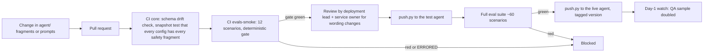

# 10 · Operations after go-live

**Scope:** how Slotback is run day to day once a pilot is live: QA sampling, alerts, incidents, agent-config changes and the monthly business review.
**Status:** operating design for a pilot that hasn't happened. The demo implements the four console alerts, the kill switch and config versioning; the rest is the process a hospital and vendor would agree. No figure here is a measured result.

---

## 1. Roles

| Role | Who | Owns |
|---|---|---|
| Service owner | Head of admissions (hospital) | Exceptions queue, kill switch, weekly review |
| Deployment lead | Vendor | Agent configs, evals, monthly business review |
| Integration owner | Hospital IT | Scheduling connector, waiting-list export, network access |
| Data protection | Hospital DPO | Privacy incidents, DPIA updates, retention |
| On-call | Vendor engineer + hospital IT contact | Alerts outside office hours (calls only run Mon–Sat 09:00–20:00 Europe/Madrid, so on-call is light) |

## 2. Daily QA sampling

Every working day, before 11:00, a QA reviewer (vendor) and an admissions clerk (hospital) go through:

| Sample | Size | Checks |
|---|---|---|
| All calls the leak detector flagged | 100% | Was health data said before verification, or to a third party or a voicemail? |
| All calls handed to a human | 100% | Was the handoff right? Did staff follow up? |
| All failed identity checks and lockouts | 100% | ASR problem, wrong data on file, or a real attempt to get someone else's details? |
| Random completed calls | 10 per day (stratified by flow and language) | AI disclosure, recording notice, identity before detail, read-back, tone, no clinical advice |
| Backfill chains | 3 per day | Offers followed list order (the verifier checks this automatically; a human looks at the transcript too) |

Each sampled call is scored on the rubric from `08_evals.md`. Failures go to the incident process (§4) if they touch privacy or list order, or to the eval backlog if they're quality issues. A recurring failure becomes a new test scenario before the next config change.

Recordings and transcripts are kept only as long as the retention period set in the DPIA. In the `production-reference` profile, the platform keeps no recordings (zero retention); QA then works from our own minimal call log and the ledger, plus calls the patient or staff flag.

## 3. Alerts

The console shows four alerts (D24). Each one has an owner and a first action.

| Alert | Fires when | Severity | Owner | First action |
|---|---|---|---|---|
| **Privacy flag** | The leak detector flags a call, or staff report one | P1 | DPO + deployment lead | Pause calls if more than one in a day; open an incident; review the transcript within 1 hour |
| **Transfer spike** | Handoffs to a human in the last hour exceed twice the trailing 7-day hourly average (threshold set at go-live) | P2 | Service owner | Check whether one flow or language is failing; pause that campaign if needed |
| **Webhook error rate > 5%** | More than 5% of tool calls in a 15-minute window return 5xx or time out | P1 | Integration owner + on-call | Check connector and Space health; the agent already apologises and offers a callback; pause new calls if it lasts 15 minutes |
| **Tool p95 > 300 ms** | Server-side p95 per tool over 15 minutes exceeds the 300 ms budget (D23) | P3 | On-call | Check database and connector latency; the agent uses a filler phrase on slow tools, so patients hear a pause, not silence |

**Also tracked on the console, without paging anyone:** identity-failure rate (a rise suggests an ASR problem, for example with a new voice or model version), opt-out rate, voicemail share, reconciliation mismatches, calls attempted outside the calling window (should always be zero).

Logs carry only `pid`, `call_id`, `tool`, `outcome` and latency (D24), with the ElevenLabs `conversation_id` as the trace ID. No names, dates of birth or specialties go into logs; a test enforces this.

## 4. Incident runbook

### Severity

| Level | Examples | Response |
|---|---|---|
| **P1** | Health data disclosed to someone other than the verified patient; offer out of list order; calls to the wrong person; calls outside the window; webhooks down | Pause calls (kill switch) at once. DPO informed within 1 hour. |
| **P2** | Transfer spike; a flow broken for one language; reconciliation mismatch above a threshold | Pause the affected campaign or flow. Fix within one working day. |
| **P3** | Latency over budget; tone complaints; a single ASR failure pattern | Fix in the next config release. |

### Steps for a P1

1. **Contain.** Press the kill switch. Calls in progress close with the callback number. Record who pressed it and when (logged automatically).
2. **Preserve.** Export the day's ledger bundle and the affected call records. Don't edit or delete anything.
3. **Assess.** Deployment lead and DPO decide within 24 hours whether it's a personal-data breach. If so, the hospital, as controller, decides on notification to the supervisory authority within 72 hours of becoming aware (GDPR Art. 33) and to the patient if high risk (Art. 34). The vendor, as processor, notifies the hospital without undue delay (Art. 33.2) and supplies the facts.
4. **Fix.** Root cause. Add a failing test scenario that reproduces it. Change the config or code. Run the full eval suite.
5. **Restart.** Two of the four kill-switch holders agree. Restart with a reduced campaign for one day, then normal.
6. **Learn.** Written review within 5 working days: timeline, cause, fix, the new test, and what changes in monitoring.

### Common incidents and what to check

| Symptom | Likely cause | Check |
|---|---|---|
| Patients say the agent didn't recognise their date of birth | ASR on elderly or accented speech; new voice or model version | Identity-failure rate by age band and language; roll back the last config if it rose after a release |
| Same slot offered to two patients | Should be impossible (compare-and-swap claim, D10) | Ledger verifier; slot version history; treat as P1 |
| Backfill stops moving to the next patient | Post-call webhook not arriving, or the timer sweep not running | Webhook signature errors; last sweep time (runs on each request and every 5 minutes from a scheduled job) |
| Voicemail calls marked as "no answer" | Voicemail doesn't trigger the call-initiation-failure webhook; outcome comes from the transcript or termination reason | Post-call webhook payloads for that call |
| A patient on the list was already seen or has died | Stale waiting-list export | Export timestamp; remove the entry; treat as P1 for patient experience even if no data was disclosed |

## 5. Agent-config versioning and rollback

Agent configs are code. Prompts, safety fragments, tool schemas and workflow live in `agent/` and are pushed to ElevenLabs by `push.py`; nobody edits the live agent in the web UI.



- **Version tag.** Every push records the git commit, the config version and the eval run ID. The console and each call record show which config version handled the call.
- **Rollback.** `push.py` with the previous tag restores the last known-good config. Target: under 10 minutes from decision to live. Rollback doesn't need the eval gate (it's returning to a config that already passed), but it's logged.
- **Platform changes.** When ElevenLabs changes a model, voice or API behaviour, run the full suite against the test agent before the live one. Watch the identity-failure rate for a week afterwards.
- **What needs hospital sign-off.** Any change to the disclosure line, recording notice, identity factors, voicemail script or the list of flows. Prompt tuning inside a flow needs the deployment lead only.

## 6. Monthly business review (template)

One page, sent two days before a 45-minute meeting with the director's office, head of admissions, IT and the DPO. Every number carries its provenance tag (MEASURED once the pilot runs; SIMULATED for anything from the test environment).

```markdown
# Slotback · monthly review · <month> · Hospital General (fictional)

## 1. Headline
- Billable recovered slots this month: <n> (MEASURED)   [target: <set by hospital>]
- Cost per billable recovered slot: €<x> (MEASURED)     [threshold: <from business case>]
- Privacy incidents: <n> (MEASURED)                     [target: 0]

## 2. Funnel
| Step | This month | Last month |
| Appointments in scope | | |
| Patients reached (verified) | | |
| Confirmed / cancelled / rescheduled | | |
| Slots freed | | |
| Slots offered → filled → attended → matched to booking | | |
| Billable after SMS-arm baseline | | |

## 3. Safety and quality
- Leak-detector flags: <n>, confirmed: <n>
- Offers out of list order: <n> (verifier)
- Handoffs to staff: <n>; handled within the day: <n>
- Identity failures by age band and language
- Opt-outs: <n>; complaints: <n>

## 4. Operations
- Webhook error rate, tool p95, incidents (P1/P2/P3) with one-line cause
- Config versions released; rollbacks

## 5. Reconciliation
- Fills in our ledger vs fills in the hospital's booking record; mismatches explained
- Signed daily heads delivered to the hospital: <n> of <n> days

## 6. Decisions needed
- <e.g. add a language; extend to a second specialty; change a threshold>

## 7. Next month
- <changes planned, with eval results>
```

Before a pilot runs, the same template is filled from the demo with every number as a placeholder, for example billable recovered slots <!--m:billable_recovered_slots-->9<!--/m--> and cost per recovered slot <!--m:cost_per_recovered_slot_eur-->€3.54<!--/m-->, both SIMULATED.
