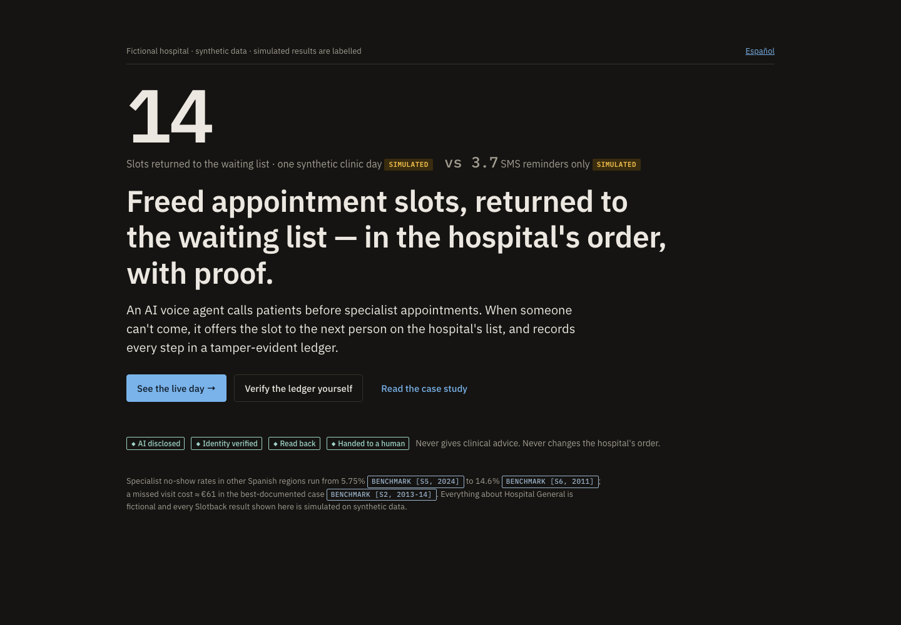
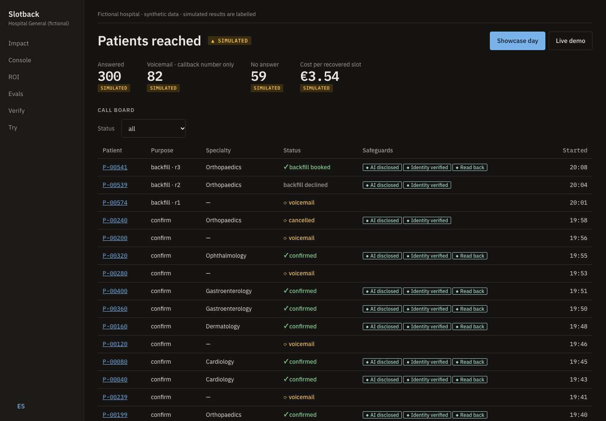
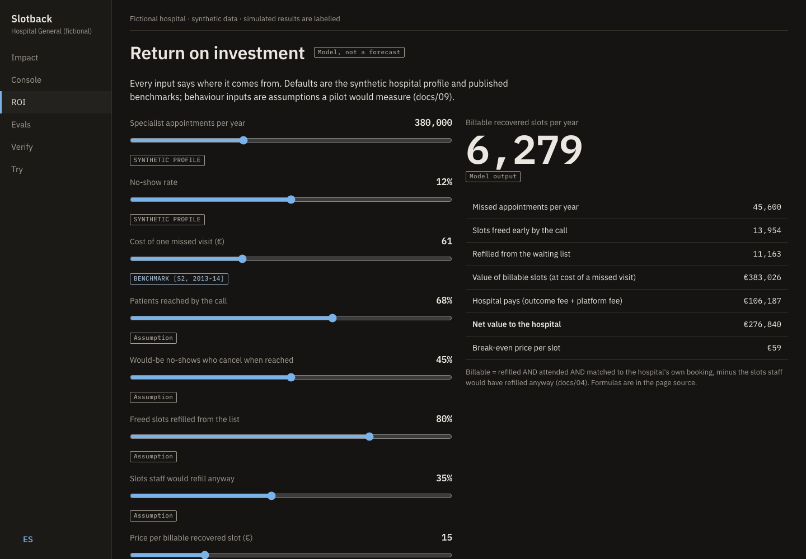
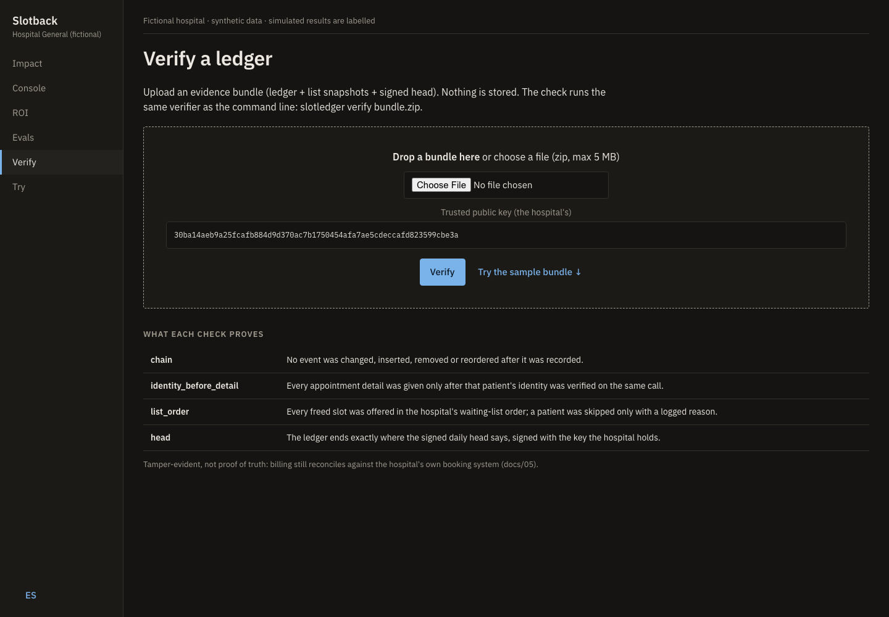

# Documents

The deployment in the order it would run with a real customer. The customer is fictional: *Hospital General*, part of a regional public health service in Spain. Ground rules for everything here: [`PRINCIPLES.md`](PRINCIPLES.md).

## Before building: understand the account

| # | Document | Answers |
|---|---|---|
| 00 | [Narrative](00_narrative.md) | The story at 30 seconds, 2 minutes and 10 minutes; the champion; what we never claim |
| 01 | [Account brief](01_account_brief.md) | How big the problem is (sourced benchmarks), who decides, who can block, why now |
| 02 | [Discovery](02_discovery.md) | What to ask each stakeholder, the current admissions process, the baseline numbers to request |
| 03 | [Use cases](03_use_cases.md) | Six candidates scored on value, feasibility and risk; why confirm-and-backfill goes first and triage never does |

## Selling it: value, price, procurement, compliance

| # | Document | Answers |
|---|---|---|
| 04 | [Business case](04_business_case.md) | ROI model, break-even, per-recovered-slot vs per-minute pricing, the billable definition, how a Spanish public hospital buys this |
| 04b | [Tender specification (Spanish)](04b_tender_spec.md) | A draft *pliego de prescripciones técnicas* for the pilot, with acceptance criteria and a kill switch |
| 05b | [DPIA draft (Spanish / English)](05b_dpia_draft.md) | Processing description, necessity, data flow, risk register, data-subject rights, sign-off |

## Building it

| # | Document | Answers |
|---|---|---|
| 05 | [Solution design](05_solution_design.md) | Architecture, components, data classification, security, failure modes, FHIR R4 mapping, demo vs production |
| 06 | [Conversation design](06_conversation_design.md) | Call flows, identity, voicemail and third parties, edge cases, voice and language |
| 07 | [UX](07_ux.md) · [wireframes](wireframes/) · [visual system](../DESIGN.md) | The dashboard: who uses each page and what it must show |
| 08 | [Evals](08_evals.md) | The release gate: personas, deterministic vs advisory checks, the leak detector, CI |

## Running it

| # | Document | Answers |
|---|---|---|
| 09 | [Pilot plan](09_pilot_plan.md) | 90 days, one specialty, an SMS-only control group, go/no-go criteria, scale path |
| 10 | [Operations](10_operations.md) | Roles, daily QA sampling, alerts, incident runbook, agent-config rollback, monthly business review |
| — | [Executive readout](../readout/) | Ten slides and a memo for the hospital director, Spanish first |
| 11 | [Field notes to Product](11_product_feedback.md) | What the platform should add, from what this deployment hit |

## Decisions and evidence

- [**DECISIONS.md**](DECISIONS.md): every decision during the build, with the reason and the alternative, including what the eval gate and the real calls found.
- [**Design review record**](designs/slotback-full-build.md): the scope, engineering and design reviews before the build, with decision codes (D, E, OV, ENG, EOV, T) referenced across these docs.
- [**OPEN_QUESTIONS.md**](OPEN_QUESTIONS.md): what was open and how each was closed.
- [**Demo calls**](../demo/) · [**Ledger evidence**](../evidence/) · [**Eval results**](../evals/results/latest.json)

## The dashboard

| | |
|---|---|
|  |  |
|  |  |
|  |  |
